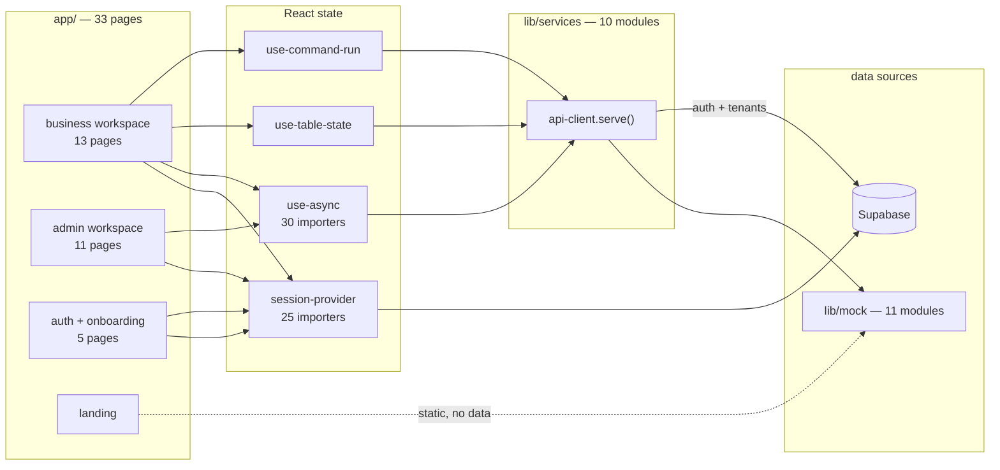

# 00 — System inventory

Every component found in the repository, with its real status.

**Method.** Directory walk of `app/`, `components/`, `lib/`, `tests/`,
`scripts/`, `supabase/`; `package.json` dependency audit; import-graph
extraction over all 153 `.ts`/`.tsx` files; keyword search for AI and
infrastructure machinery.

**Status vocabulary** (from the analysis rules):

| Status | Meaning |
| --- | --- |
| **USED** | Implemented, and something calls it |
| **UNUSED** | Implemented, nothing imports or calls it |
| **PARTIAL** | Implemented for one path only |
| **CONFIGURED-UNUSED** | Declared in config, never read by executing code |
| **STAGED** | Written and correct, but never executed anywhere yet |
| **ABSENT** | Does not exist. Listed because the architecture implies it |

---

## Census

| Measure | Count |
| --- | --- |
| TypeScript / TSX files | 153 |
| of which `"use client"` | 89 |
| Pages (`page.tsx`) | 33 |
| HTTP route handlers (`route.ts`) | **0** |
| Service modules | 10 |
| Service paths declared | 66 |
| SQL migrations | 9 |
| Database tables | 24 |
| Postgres enums | 37 |
| RLS policies | 50 |
| Indexes | 39 |
| Triggers / PL-pgSQL functions | 13 / 10 |
| Unit test files / assertions | 7 / 220 |
| Runtime dependencies | 31 |

---

## Master table

Component | Technology | Location | Purpose | Called by | Calls | Status
--- | --- | --- | --- | --- | --- | ---
**Route guard** | Next middleware | `middleware.ts` | Rejects unauthenticated requests before HTML exists | Next.js runtime, every matched request | `updateSession`, `redirectWithSession` | USED
Session refresher | `@supabase/ssr` | `lib/supabase/middleware.ts:18` | Validates the cookie against the auth server | `middleware.ts:29` | Supabase Auth | USED
Redirect helper | Next | `lib/supabase/middleware.ts:50` | Carries refreshed cookies onto a redirect | `middleware.ts` ×4 | — | USED
Guard config | TS constants | `lib/supabase/config.ts` | Which paths need a session; cookie names | `middleware.ts`, provider, tests | — | USED
**Browser Supabase client** | `@supabase/ssr` | `lib/supabase/client.ts` | Cookie-backed client, memoised | auth/business services, provider | Supabase | USED
Server Supabase client | `@supabase/ssr` | `lib/supabase/server.ts` | Server-component client | **nothing** | Supabase | **UNUSED**
Session mapper | TS | `lib/supabase/session.ts:41` | Supabase identity → domain `Session` | `auth-service` ×3 | `profiles`, `business_users` | USED
Role reader | TS | `lib/supabase/session.ts:18` | `app_metadata.role` → `UserRole` | `loadSession`, tests | — | USED
Tenant repository | `supabase-js` | `lib/supabase/businesses.ts` | Read/write `businesses` and children | `business-service` | 4 tables | USED
Demo bridge | TS `Map` | `lib/mock/demo-bridge.ts` | Real tenant UUID → mock dataset key | `business-data.ts:569`, `businesses.ts:98` | — | USED (temporary)
**Service transport** | fetch / closure | `lib/services/api-client.ts:78` | The one seam: mock resolver or HTTP | all 10 services | `lib/mock` **or** FastAPI | PARTIAL — mock branch only
Pagination pipeline | TS | `lib/services/api-client.ts:108` | Search, filter, sort, page for every table | 6 services | — | USED
Auth service | TS | `lib/services/auth-service.ts` | Sign in/up, reset, session | login/register/reset pages, provider | Supabase Auth **or** mock | USED
Business service | TS | `lib/services/business-service.ts` | Tenants, capabilities, onboarding write | 8 pages, provider | `lib/supabase/businesses` + `lib/mock` | USED
Customer service | TS | `lib/services/customer-service.ts` | Customer list, stats, detail | customers page, drawer | `lib/mock` | USED
Operations service | TS | `lib/services/operations-service.ts` | Appointments, payments, inventory, documents | 4 pages | `lib/mock` | USED
Approval service | TS | `lib/services/approval-service.ts` | Approve, reject, edit batch items | approvals page, command page, admin | `lib/mock` + `recordActivity` | USED
Workflow service | TS | `lib/services/workflow-service.ts` | Plan a command, build a run, history | command page, automations, admin | `lib/mock/workflows` | USED
Insight service | TS | `lib/services/insight-service.ts` | Activity feed, report bundle | activity, reports pages | `lib/mock` | USED
Admin service | TS | `lib/services/admin-service.ts` | Platform roll-ups, health, integrations | 8 admin pages | `lib/mock/platform` | USED
**Command classifier** | keyword scoring | `lib/mock/workflows.ts:80` | Text → one of 9 intents | `planCommand:164` | — | USED
Plan builder | TS | `lib/mock/workflows.ts:164` | Intent → `CommandPlan` with tenant vocabulary | `workflow-service.plan` | `lib/domain` | USED
Step-graph builder | TS | `lib/mock/workflows.ts:202-777` | Intent → 3–6 `WorkflowStep`s with real counts | `buildRun:778` | `business-data`, `approvals` | USED
Run animator | React hook | `lib/hooks/use-command-run.ts:36` | Advances steps on `setTimeout` | `app/app/command/page.tsx` | `workflow-service` | USED
**Mock dataset** | seeded PRNG | `lib/mock/business-data.ts` | 264 customers, 397 invoices, 780 bookings | 6 services | `lib/mock/seed` | USED
Deterministic RNG | TS | `lib/mock/seed.ts:rngFor` | Stable fake data across reloads | all mock modules | — | USED
Approval fixtures | TS | `lib/mock/approvals.ts` | 15 batches, 147 items, drawn from real rows | approval service, workflows, metrics | `business-data` | USED
Activity log | mutable array | `lib/mock/activity.ts` | Audit feed; `recordActivity` appends | insight/approval services, metrics | — | USED
Metrics | TS | `lib/mock/metrics.ts` | KPIs, chart series, attention items | business/insight services | `business-data`, `approvals` | USED
Capability catalogue | TS constant | `lib/mock/capabilities.ts` | The 9 capabilities and their actions | 21 modules | — | USED
Agent roster | TS constant | `lib/mock/agents.ts` | 11 rows of **display metadata** | `admin/agents`, seed generator | — | **CONFIGURED-UNUSED as agents** |
Workflow definitions | TS constant | `lib/mock/agents.ts` | 8 catalogue entries for the admin table | `admin/workflows`, automations | — | USED as data
Platform dataset | TS | `lib/mock/platform.ts` | Tenant roll-ups, health, errors, integrations | `admin-service` | — | USED
**Domain vocabulary** | TS maps | `lib/domain.ts` | Per-industry nouns; every status → tone | 36 modules | — | USED
Type model | TS | `lib/types.ts` | Every entity in one file | 36 modules | — | USED
App config | TS | `lib/config.ts` | Brand, data mode, API, Supabase, LLM, integrations | 8 modules | — | PARTIAL — `config.llm` unread
Navigation model | TS | `lib/navigation.ts` | Capability-aware sidebar | shell, palette, layouts | `lib/domain` | USED
Utilities | TS | `lib/utils.ts` | `cn`, currency, dates, text | **90 modules** — hottest | — | USED
**Session provider** | React context | `components/providers/session-provider.tsx` | Session + active tenant, cookie-backed | 25 modules | `auth-service`, `business-service` | USED
Theme provider | `next-themes` | `components/providers/theme-provider.tsx` | Light/dark | `app-providers` | — | USED
App shell | React | `components/layout/app-shell.tsx` | Sidebar + topbar + mobile nav | both workspace layouts, 27 pages | `sidebar`, `topbar`, `mobile-nav` | USED
Command palette | `cmdk` | `components/layout/command-palette.tsx` | ⌘K navigation and AI shortcuts | both layouts | router, `setActiveBusiness` | USED
Tenant switcher | React | `components/layout/business-switcher.tsx` | Change active workspace | sidebar header | `setActiveBusiness` | USED
Data table | React | `components/tables/data-table.tsx` | Search/filter/sort/page for 6 screens | 6 pages | `useTableState` | USED
Chart kit | Recharts | `components/charts/chart-kit.tsx` | Area, bar, donut, sparkline | overview, reports, admin | Recharts | USED
Approval drawer | Radix Sheet | `components/approvals/approval-drawer.tsx` | Per-record review, edit, approve | approvals + command pages | `approval-service` | USED
Workflow panel | React | `components/command/workflow-panel.tsx` | Renders the simulated run | command page | `workflow-step-card` | USED
UI primitives | Radix + CVA | `components/ui/` (21 files) | Button, table, dialog, sheet, select… | everywhere | Radix | USED
**Migrations** | SQL | `supabase/migrations/` (9) | 24 tables, RLS, triggers, storage | `supabase db push` | Postgres | **STAGED — never executed**
Isolation suite | pgTAP | `supabase/tests/rls.test.sql` | Proves cross-tenant reads return zero rows | `supabase test db` | Postgres | STAGED
Seed | generated SQL | `supabase/seed.sql` (1.2 MB) | The three demo tenants | `supabase db reset` | Postgres | STAGED
Seed generator | tsx script | `scripts/generate-seed.ts` | `lib/mock` → `seed.sql` | `npm run seed:generate` | all mock modules | USED
Reset script | SQL | `supabase/reset-remote.sql` | Wipes a project to empty | run by hand | Postgres | STAGED
OneDrive workaround | Node script | `scripts/clean-next-diagnostics.mjs` | Removes `.next/diagnostics` before dev | `predev` hook | fs | USED
Build guard | Node | `next.config.mjs:22` | Fails the build without Supabase env | `next build` | — | USED
CI | GitHub Actions | `.github/workflows/ci.yml` | verify + database jobs | GitHub | npm, supabase CLI | USED
Unit tests | Vitest | `tests/unit/` (7 files) | 220 assertions | `npm test` | `lib/*`, migration SQL | USED

---

## Absent components

Listed because the product description implies them. Each was searched for
across all source files; the count is occurrences found.

| Component | Occurrences | Conclusion |
| --- | --- | --- |
| LLM SDK (`@anthropic-ai/sdk`, `openai`) | 0 in `package.json` | **ABSENT** |
| `messages.create`, `chat.completions` | 0 | **ABSENT** — no model is ever called |
| System / user prompt strings | 0 (`systemPrompt`, `system_prompt`) | **ABSENT** |
| Tool or function definitions for an LLM | 0 (`tool_use`, `function_call`) | **ABSENT** |
| Agent classes or orchestration code | 0 | **ABSENT** — `lib/mock/agents.ts` is data |
| LangChain / LangGraph / LlamaIndex | 0 | **ABSENT** |
| Embeddings, vector store, reranker | 0 (`embedding`, `pgvector`, `pinecone`, `rerank`) | **ABSENT** — no RAG |
| Queue / worker (Celery, BullMQ, Redis) | 0 | **ABSENT** |
| Scheduler (cron, pg_cron) | 0 | **ABSENT** — "always-on automations" are UI toggles |
| WebSocket / SSE | 0 (`WebSocket`, `EventSource`, `text/event-stream`) | **ABSENT** |
| HTTP route handlers | 0 `route.ts` files | **ABSENT** |
| FastAPI / any Python | 0 files | **ABSENT** |
| Dockerfile / compose | 0 | **ABSENT** |
| Observability (Sentry, OpenTelemetry) | 0 | **ABSENT** — `console.error` in 2 error boundaries |
| Caching layer | 0 | **ABSENT** — `useAsync` refetches per mount |

---

## Unused and dead

| Item | Location | Evidence |
| --- | --- | --- |
| `date-fns` dependency | `package.json` | Zero imports across all source. Date work is hand-rolled in `lib/utils.ts` |
| `getServerSupabase`, `getServerUser`, `getActiveBusinessId` | `lib/supabase/server.ts` | No importer. Written for phase 03 server components |
| `config.llm` (providers, models, orchestration) | `lib/config.ts:44-90` | Only read for **display** at `app/admin/agents/page.tsx:119` and `app/admin/settings/page.tsx` |
| `config.integrations` | `lib/config.ts:92-101` | Read only for display in admin settings |
| `config.api`, `isBackendConnected()` | `lib/config.ts` | Read by `api-client.ts` but the `api` branch never executes — `DATA_MODE` is `mock` |
| `clearDemoAliases()` | `lib/mock/demo-bridge.ts:35` | Declared as a test seam; no test calls it |
| `usingRealAuth()` | `lib/services/auth-service.ts:55` | Exported, no importer |
| `ApiError.status` / `.path` | `lib/services/api-client.ts:13` | Constructed but never inspected by any caller |
| `Task` type and `tasks` table | `lib/types.ts`, migration 3 | `tasksFor()` derives tasks from activity; the table is never written |
| `HealthComponent`, `SystemError` | `lib/types.ts` | Mock only — no table exists for them |

---

## Component relationship map

The landing page reads `lib/mock/capabilities` and `lib/domain` directly at
build time — it is the only surface that bypasses the service layer, and it is
static so this is intentional.

---

## Where each subsystem's truth lives

| To understand… | Read this one file |
| --- | --- |
| Every entity and field | `lib/types.ts` (620 lines) |
| Where data comes from | `lib/services/api-client.ts` (152 lines) |
| Industry vocabulary, status colours | `lib/domain.ts` (400 lines) |
| Every configurable value | `lib/config.ts` (127 lines) |
| Who may see what | `supabase/migrations/…_rls.sql` |
| The "AI" | `lib/mock/workflows.ts` (848 lines) |
| Session and tenancy | `components/providers/session-provider.tsx` |
