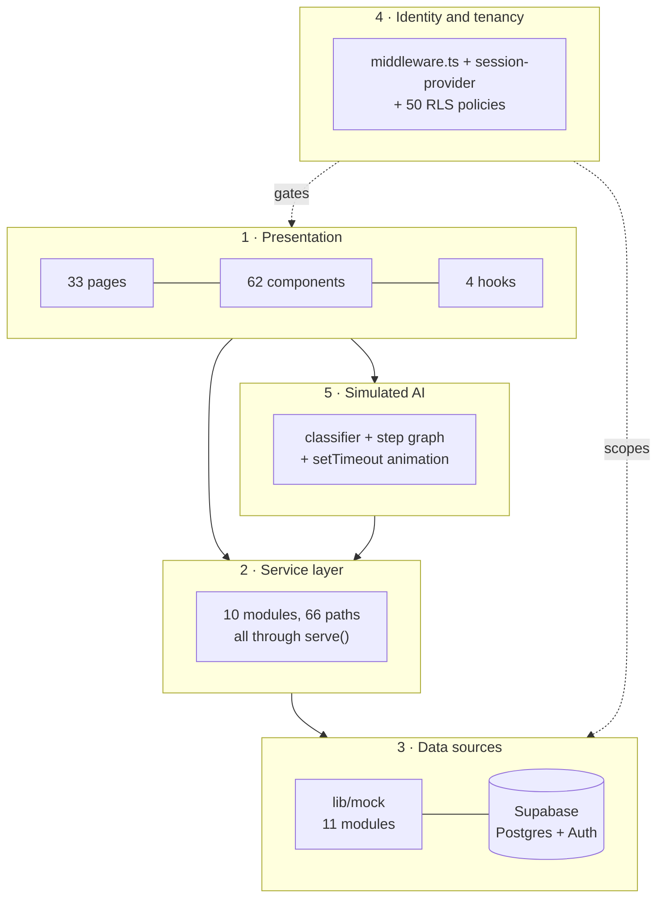

# 01 — System overview

---

## Part 1: in plain language

### What is this application?

A web app that small businesses sign into to run their day-to-day admin. A salon
owner opens it and sees today's appointments, who owes money, and who has not
been in for a while. They type a request in plain English — *"find overdue
payments and prepare reminders"* — and the app shows work being done: seventeen
overdue customers found, seventeen messages drafted, and then it **stops** and
asks the owner to approve before anything is sent.

The same app serves a gym, a retail shop, a garage or a coaching centre. It does
not become a different app for each one; it uses different words and switches
different features on.

### What problem does it solve?

The follow-ups that never get done. A salon owner spends the day cutting hair,
not chasing the eleven people who owe money or reminding tomorrow's customers to
confirm. That work is valuable, repetitive, and always last on the list. This app
is meant to do it and ask permission before anything reaches a customer.

### Who uses it?

Three groups, and only two of them sign in.

1. **Business owners and their staff** — the customers. One private workspace per
   business at `/app`.
2. **The platform team** — whoever operates the product. A separate workspace at
   `/admin` for watching all tenants at once.
3. **The businesses' own customers** — never sign in. They are meant to arrive
   through a booking link, WhatsApp or email. *Those channels do not exist in the
   code yet.*

### What can it actually do today?

**Real:** create an account, sign in, sign out, reset a password, create a
business workspace, choose which capabilities it has, switch between workspaces,
and be blocked from anyone else's workspace by the database itself.

**Demonstrated but not real:** everything else. The customers, invoices,
bookings, approval batches and activity trail are convincing sample data
generated in your browser. The "AI" that appears to work through a task is a
keyword matcher plus a timed animation.

That is not a criticism — it is where the project is. The frontend is finished,
the database is designed, authentication is real, and the AI is next.

### How does it hang together?

Think of four layers:

1. **The screens** — 33 pages of React.
2. **A single doorway for data.** Every screen asks for data the same way, and
   one function decides where it comes from. Today it comes from sample data in
   the browser. When a real server exists, that one function changes and no
   screen changes.
3. **The gatekeeper.** Before any page is built, a guard checks whether you are
   signed in. If not, you get sent to the sign-in page and no page is ever built.
4. **The database.** Postgres, where every row is stamped with which business owns
   it, and the database itself refuses to hand one business another's rows.

---

## Part 2: technically

### Stack

| Layer | Choice | Where |
| --- | --- | --- |
| Framework | Next.js 15.5 App Router, React 19 | `app/` |
| Language | TypeScript 5.7, `strict: true` | `tsconfig.json` |
| Styling | Tailwind 3.4 + CSS custom properties | `tailwind.config.ts`, `app/globals.css` |
| Components | Radix primitives + CVA variants | `components/ui/` |
| Charts | Recharts 2.15 | `components/charts/chart-kit.tsx` |
| Auth | Supabase Auth, cookie sessions via `@supabase/ssr` | `lib/supabase/` |
| Database | Postgres (Supabase), row-level security | `supabase/migrations/` |
| Tests | Vitest — 220 assertions, no browser driver | `tests/unit/` |
| CI | GitHub Actions — verify + database jobs | `.github/workflows/ci.yml` |
| Backend API | **None.** No `route.ts`, no FastAPI, no Python | — |
| AI | **None.** See `05`–`10` | — |

### The five subsystems



**1 · Presentation.** `app/` holds the routes; `components/` holds everything
reusable. 89 of 153 files are client components — this is a dashboard, so most
of it is interactive.

**2 · Service layer.** `lib/services/` — ten modules, 66 declared paths. Almost
no component fetches anything itself. 21 files do import from `lib/mock`, but 20
of those import only the static capability catalogue (`capabilityMeta`,
`CAPABILITIES`, `SUGGESTED_COMMANDS`) — domain metadata that is simply filed in
the wrong folder. The one real bypass is
`components/layout/notifications.tsx:12`, which calls `attentionItems()` without
going through `serve()`. See `12_DATA_FLOW.md`. That discipline, held everywhere
else, is what makes the backend swap a one-file change.

**3 · Data sources.** Two, live simultaneously. `lib/mock/` generates the
business records from a seeded PRNG. Supabase serves identity and the tenant
list. `lib/mock/demo-bridge.ts` reconciles them by mapping a real tenant UUID
onto a mock dataset key.

**4 · Identity and tenancy.** Three enforcement points: `middleware.ts` (before
HTML), `session-provider` (which tenant is active), and 50 RLS policies (the
database refuses cross-tenant reads).

**5 · Simulated AI.** `lib/mock/workflows.ts` classifies the request and builds a
step graph whose numbers are read from the real mock dataset;
`use-command-run.ts` reveals the steps on timers.

### What happens when a user opens the application

Signed out, requesting `/app/overview`:

```
GET /app/overview
  → middleware.ts:20 runs first
  → isSupabaseConfigured() true → updateSession() validates the cookie
  → no user → 307 to /login?next=%2Fapp%2Foverview
  → 29-byte body; no workspace HTML is ever generated
```

Signed in:

```
GET /app/overview
  → middleware refreshes the session, reads app_metadata.role
  → BUSINESS_USER on an /app path → allowed
  → app/layout.tsx mounts AppProviders (theme → session → tooltip → toaster)
  → SessionProvider calls authService.currentSession()
       → supabase.auth.getUser()
       → loadSession(): reads profiles + business_users
       → businessService.list() → real rows from Supabase
  → app/app/layout.tsx renders AppShell with capability-derived navigation
  → app/app/overview/page.tsx calls businessService.overview()
       → serve() → mock metrics → KPIs, charts, attention list
  → skeletons resolve into content
```

### How the frontend and "backend" communicate

There is no backend to communicate with. `lib/services/api-client.ts:78`:

```ts
export async function serve<T>(path, resolver, options = {}): Promise<T> {
  if (DATA_MODE === "api" && config.api.baseUrl) {
    return fetchFromApi<T>(path, options);   // never taken today
  }
  await sleep(options.latencyMs ?? randomLatency());
  return await resolver();                    // always taken
}
```

`DATA_MODE` comes from `NEXT_PUBLIC_DATA_MODE`, default `"mock"`
(`lib/config.ts:22`). The `api` branch is written and typed but has never
executed — no base URL exists to point it at.

Auth and tenant reads bypass `serve()`'s mock branch by calling Supabase inside
the resolver, which is why they are real while everything else is not.

### How the backend communicates with AI systems

It does not. There is no AI system. `config.llm` (`lib/config.ts:44-90`) names
`claude-opus-5`, `claude-sonnet-5` and `claude-haiku-4-5-20251001`, and those
strings are read in exactly one place — to render text in the admin UI
(`app/admin/agents/page.tsx:119`). No SDK is installed.

### How data is stored

Three places, by lifetime:

| Where | What | Survives a reload? |
| --- | --- | --- |
| Module-level JS objects | The whole mock dataset, generated at import | No |
| Cookies | Supabase session; `aibh-active-business` | Yes |
| `localStorage` | Mock session, sidebar collapsed state | Yes |
| Postgres | `auth.users`, `profiles`, `businesses`, `business_users`, `business_hours`, `business_capabilities` | Yes |

Mock mutations — approving a batch, marking an invoice paid — write to the
in-memory arrays and vanish on refresh.

### How asynchronous processing works

It does not exist. No queue, no worker, no scheduler. What resembles it:

- `useAsync` (`lib/hooks/use-async.ts`) — a promise with loading/error state and
  a cancellation flag.
- `use-command-run` — `await sleep(durationMs * 0.42)` per step, which is what
  makes a workflow *look* like it is working.
- The Automations page lists eight "always-on automations" with switches. The
  switches change local React state and fire a toast. Nothing is scheduled.

### How agents are orchestrated

They are not. `lib/mock/agents.ts` exports eleven objects with fields like
`name`, `model`, `provider`, `tools`, `successRate`. Nothing imports them except
the admin table and the seed generator. No code constructs an agent, sends it a
message, or reads its output.

What *simulates* orchestration: `buildSteps()` (`lib/mock/workflows.ts:202`) is a
switch over nine intents, each branch returning a hand-written array of steps
with `actor: "Payment Agent"` and so on. The actor names are strings in a UI
card.

### How LLMs are selected and called

They are not called. See `07_LLM_ARCHITECTURE.md`.

### How tools are executed

No tool abstraction exists. The step graph does read real data — `buildSteps()`
calls `overduePayments()`, `appointmentsOn()`, `lowStockItems()` — so the numbers
on screen are true to the dataset. Those functions are the natural seam for real
tools, and `09_TOOL_ARCHITECTURE.md` maps each one.

### How results return to the user

For a command run, entirely client-side:

```
page calls run.submit(command)
  → workflowService.plan()  → CommandPlan          (~260 ms simulated)
  → workflowService.start() → WorkflowRun, all steps "pending"  (~420 ms)
  → loop over steps: mark "running", await sleep(), mark "completed"
  → approval_gate step → status "awaiting_approval", loop ends
  → phase becomes "awaiting_approval"; the panel renders Approve / Review
  → workflowService.complete() writes one row to the mock activity log
```

No network request leaves the browser except the Supabase auth and tenant calls.

---

## Major features, and how real each is

| Feature | Route | Real? |
| --- | --- | --- |
| Sign in / up / reset | `/login`, `/register`, `/reset-password` | **Real** — Supabase Auth |
| Route guarding | all `/app`, `/admin`, `/onboarding` | **Real** — server-side |
| Onboarding wizard | `/onboarding` | **Real writes** — 4 tables |
| Tenant switching | sidebar | **Real** — reads `business_users` |
| Capability toggles | `/app/workforce`, `/app/settings` | **Real** — writes `business_capabilities` |
| AI Command Center | `/app/command` | Simulated |
| Approvals | `/app/approvals` | Mock data, in-memory decisions |
| Customers / payments / bookings / stock / documents | `/app/*` | Mock data |
| Reports and charts | `/app/reports` | Mock data |
| Activity trail | `/app/activity` | Mock data, appended in memory |
| Admin: tenants, capabilities, agents, workflows, health | `/admin/*` | Mock data |
