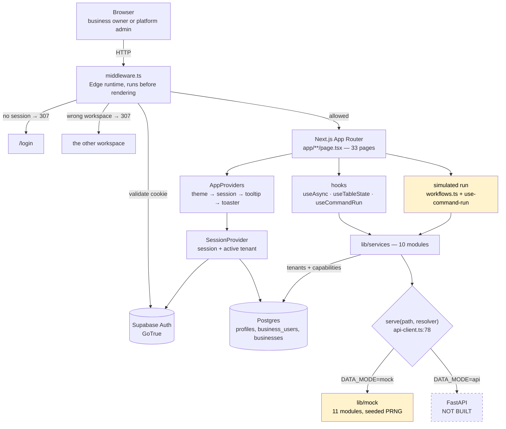
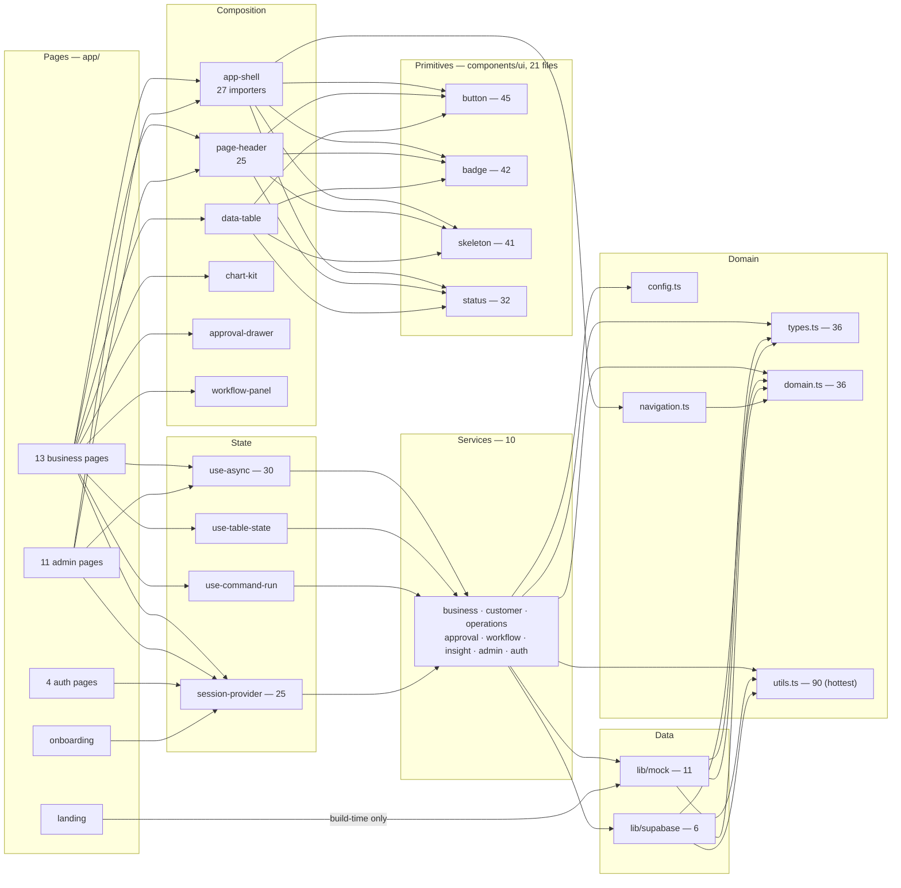
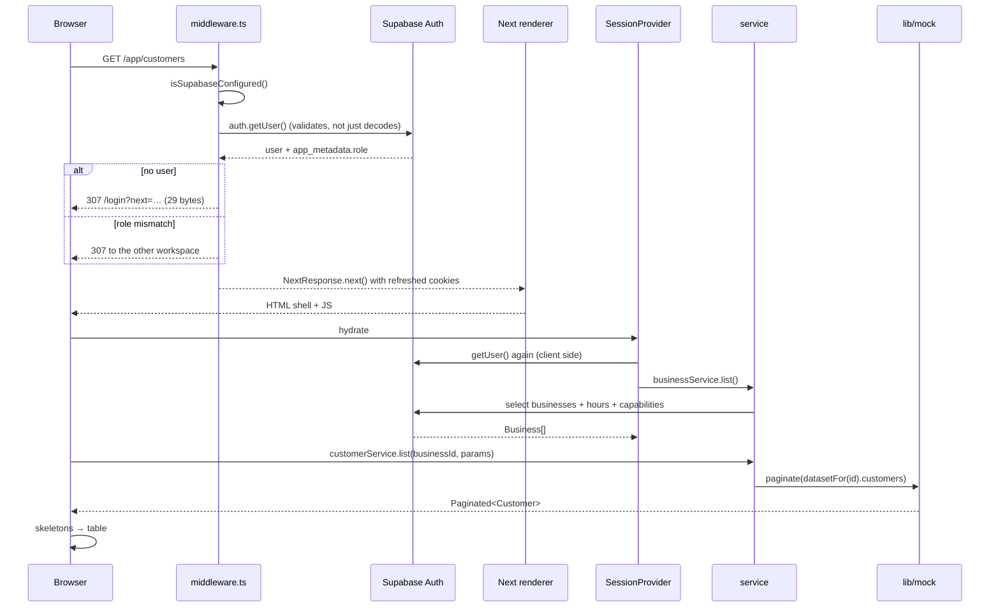
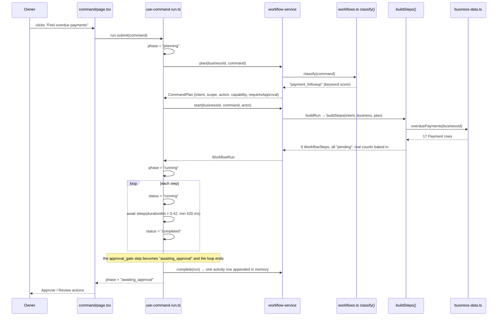
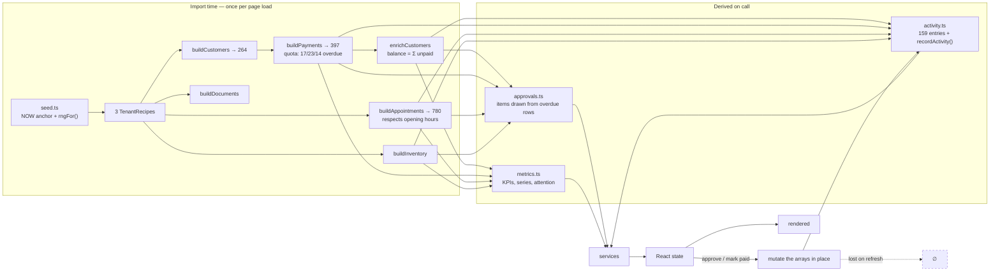
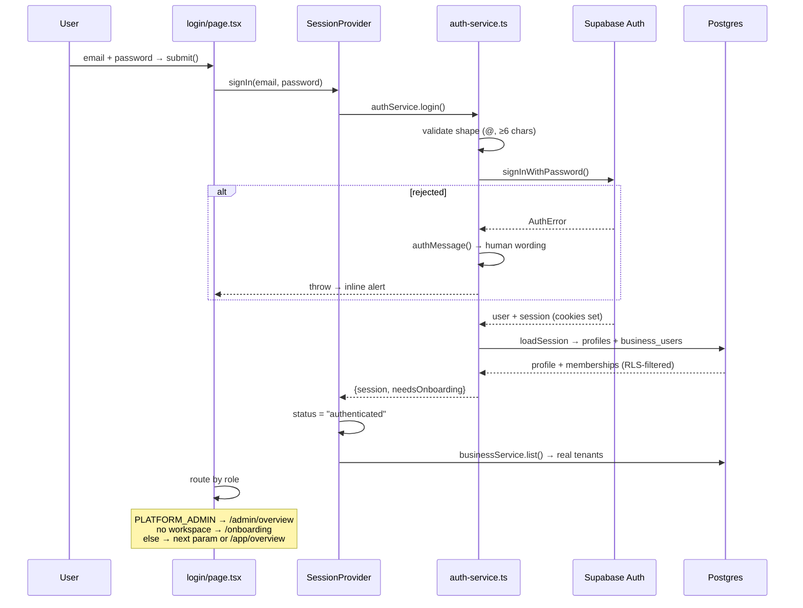
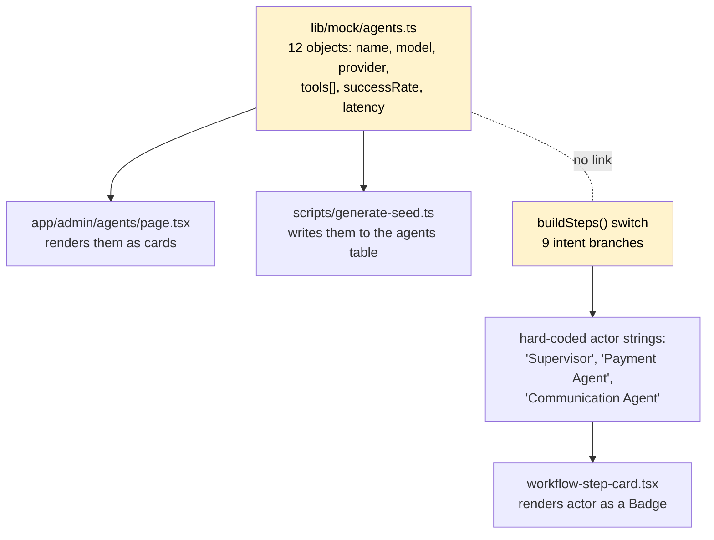
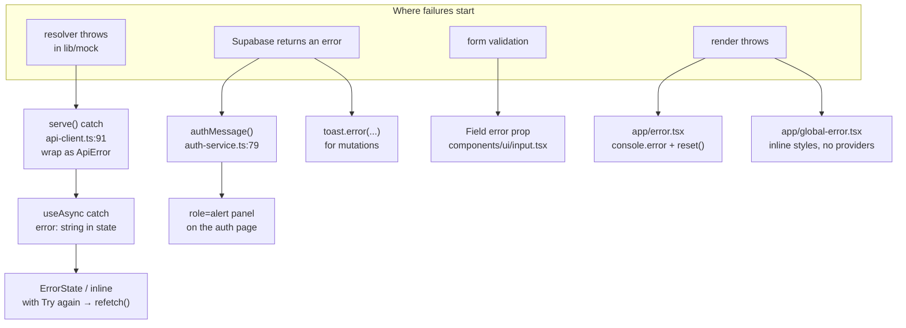
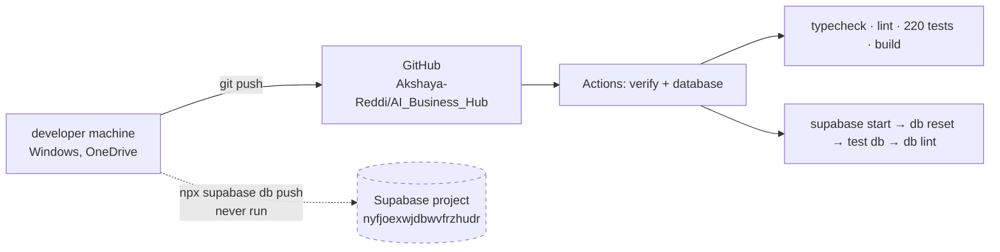

# 02 — System architecture

Diagrams of the architecture that exists. Dashed borders mark things that are
written but never execute; yellow marks mock data.

---

## A. High-level architecture

**Nodes.**

| Node | File | Role |
| --- | --- | --- |
| `middleware.ts` | `middleware.ts:20` | The only server-side gate. Matches everything except static assets |
| Supabase Auth | hosted | Validates the session cookie via `getUser()`, not `getSession()` |
| App Router | `app/` | 33 pages; 89 of 153 files are client components |
| `AppProviders` | `components/providers/app-providers.tsx` | Fixed nesting order — theme outermost so the toaster can read the resolved theme |
| `SessionProvider` | `components/providers/session-provider.tsx` | Single source of truth for who and which tenant |
| hooks | `lib/hooks/` | Only four; no data library |
| services | `lib/services/` | The only layer allowed to know where data lives |
| `serve()` | `api-client.ts:78` | The branch point. `api` side has never executed |
| `lib/mock` | 11 modules | Deterministic dataset built at import |

**Edges that do not exist:** service layer → FastAPI (no server), anything → LLM,
anything → queue.

---

## B. Component dependency diagram

Layering is respected in one direction: pages → services → data — with two
qualifications. 20 files import the static capability catalogue from
`lib/mock/capabilities` (domain metadata in the wrong folder, harmless), and
`components/layout/notifications.tsx:12` fetches `attentionItems()` from
`lib/mock/metrics` without going through `serve()` — the one genuine layering
violation in the codebase. See `12_DATA_FLOW.md`.

---

## C. Request lifecycle

`getUser()` is called twice — once in middleware, once on hydration. That is a
confirmed redundancy, noted in `25_PERFORMANCE_ARCHITECTURE.md`.

---

## D. AI request lifecycle

**This is a simulation.** No model is contacted.

**Where a real model would attach:** replace `classify()` + `buildSteps()` with a
supervisor loop. `workflow-service.plan()` and `.start()` are the only two
functions the UI calls, so the panel and step cards do not change.

---

## E. Data flow

The chain `buildPayments → enrichCustomers` is why a customer's outstanding
balance always equals the sum of their unpaid invoices — and the same reason the
seventeen the Payment Agent "finds" are the seventeen in the approval drawer.
`tests/unit/dataset.test.ts` asserts both.

---

## F. Authentication flow

Two things worth noting. `businessRole` on the session is the role for the
*active* workspace only (`session.ts:63`) — a user with three memberships has
three roles and the type holds one. And the role that gates `/admin` comes from
`app_metadata`, never `user_metadata`, because the user can write the latter
(`session.ts:18`, asserted in `tests/unit/auth-guard.test.ts`).

---

## G. Agent orchestration flow

**No orchestration exists.** This is what the code represents instead:

The agent roster and the step actors are **two unconnected string sets**. Nothing
resolves `"Payment Agent"` in a step back to `agt_payment` in the roster. Full
detail in `05_AGENT_ARCHITECTURE.md`.

---

## H. RAG flow

**Absent.** No embeddings, no vector column, no retrieval. See
`10_RAG_ARCHITECTURE.md`.

---

## I. Background job flow

**Absent.** No queue, worker or scheduler. `16_ASYNC_PROCESSING.md` documents
the three things that resemble it.

---

## J. Error handling flow

`ApiError` carries `status` and `path` (`api-client.ts:13`), and **no caller ever
reads them** — every consumer uses `error.message`. Noted in `26`.

---

## Frontend architecture

- **Routing:** file-based. Two route groups — `(auth)` for a shared split-screen
  layout, and nested `app/app` / `app/admin` for the two workspaces.
- **Client/server split:** pages that fetch are client components. `app/page.tsx`
  (landing), `app/not-found.tsx`, `app/robots.ts`, `app/sitemap.ts` and
  `app/opengraph-image.tsx` are server-rendered.
- **State:** React context for session; local `useState` everywhere else. No
  Redux, Zustand or React Query.
- **Data fetching:** `useAsync` — 42 lines, `{data, loading, error, refetch, mutate}`.
  Deliberately swappable for React Query later.
- **Suspense:** five pages that read `useSearchParams` wrap themselves in
  `<Suspense>` because Next requires it for static generation.

## Backend architecture

What exists: `middleware.ts` on the Edge runtime, and Supabase (Postgres, Auth,
Storage) as a hosted service. That is the entire server.

What does not: any route handler, server action, controller, repository layer, DI
container, logger or job runner.

## Database architecture

24 tables, 37 enums, 50 policies, 39 indexes, 13 triggers, 10 functions. Every
tenant table carries `business_id` and every index leads with it. Full ER diagram
in `11_DATABASE_ARCHITECTURE.md`.

## Storage architecture

One private bucket, `documents`, created in migration 9, with path convention
`{business_id}/…` and four policies keyed off the first path segment. **Nothing
uploads to it** — `documents.storage_path` is nullable and never written.

## Integration architecture

`lib/mock/platform.ts` lists eleven integrations with `requiredKeys` naming
environment variables. Ten are catalogue rows for the admin UI. One — Supabase —
is genuinely connected. See `17_EXTERNAL_INTEGRATIONS.md`.

## Infrastructure architecture

No deployment target is configured — no Vercel config, no Dockerfile, no
`vercel.json`. See `24_DEPLOYMENT_ARCHITECTURE.md`.
