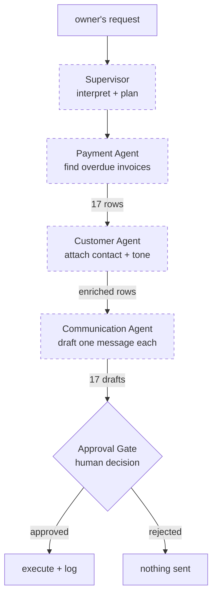

# 05 — Agent architecture

## Status: no agent exists

**Finding.** This repository contains no AI agent. There is no class, function or
module that constructs an agent, sends it input, receives its output, or passes
state between two of them. Searched across all 153 source files:

| Searched for | Occurrences |
| --- | --- |
| Agent class or constructor | 0 |
| LangChain / LangGraph / LlamaIndex / CrewAI / AutoGen | 0 |
| `tool_use`, `function_call`, `toolChoice` | 0 |
| `systemPrompt`, `system_prompt`, `messages.create`, `chat.completions` | 0 |
| Any LLM SDK in `package.json` | 0 |

What the word "agent" refers to in this codebase is **two unrelated sets of
strings**:

1. **A roster of 11 metadata objects** in `lib/mock/agents.ts`, rendered as cards
   in the admin workspace. They have `model` and `provider` fields that nothing
   reads at runtime.
2. **Hard-coded `actor` labels** inside the step graph in
   `lib/mock/workflows.ts`, rendered as a badge on a step card.

These two sets are never joined at runtime. Nothing resolves `"Payment Agent"` in
a step back to `agt_payment` in the roster.

If you need to describe this system accurately, the sentence is: *"the agent
model is designed — capabilities, actors, approval gates, an audit trail — and
the execution layer that would make them real has not been built. The seam is
two functions wide."*

---

## What exists: the roster

`lib/mock/agents.ts` exports `AGENTS: Agent[]` — 11 rows, 1 supervisor and 10
specialists. The type is `lib/types.ts` `Agent`:

```ts
export interface Agent {
  id: string;
  name: string;
  kind: "supervisor" | "specialist";
  capability?: CapabilityKey;   // unset only for the supervisor
  role: string;
  description: string;
  status: AgentStatus;          // online | idle | degraded | offline
  model: string;                // a string. Nothing reads it to make a call
  provider: "anthropic" | "openai" | "google" | "unassigned";
  tools: string[];              // display labels, not callable functions
  avgLatencyMs: number;         // fabricated
  tasksToday: number;           // fabricated
  successRate: number;          // fabricated
  escalationRate: number;       // fabricated
  lastRunAt: string;
  version: string;
}
```

| id | name | kind | capability | model (string only) | status |
| --- | --- | --- | --- | --- | --- |
| `agt_supervisor` | Supervisor | supervisor | — | `claude-opus-5` | online |
| `agt_support` | Support Agent | specialist | `customer_support` | `claude-sonnet-5` | online |
| `agt_booking` | Booking Agent | specialist | `appointments` | `claude-sonnet-5` | online |
| `agt_payment` | Payment Agent | specialist | `payment_followup` | `claude-sonnet-5` | online |
| `agt_customer` | Customer Agent | specialist | `customer_followup` | `claude-sonnet-5` | online |
| `agt_communication` | Communication Agent | specialist | `communication` | `claude-sonnet-5` | online |
| `agt_inventory` | Inventory Agent | specialist | `inventory` | `claude-haiku-4-5-20251001` | idle |
| `agt_reporting` | Reporting Agent | specialist | `reports` | `claude-sonnet-5` | online |
| `agt_documents` | Document Agent | specialist | `documents` | `claude-sonnet-5` | online |
| `agt_reminder` | Reminder Agent | specialist | `reminders` | `claude-haiku-4-5-20251001` | online |
| `agt_voice` | Voice Agent | specialist | `customer_support` | `unassigned` | degraded |

**Who reads this array:**

| Reader | Use |
| --- | --- |
| `app/admin/agents/page.tsx` | Renders each as a card, with the `model` string as caption |
| `scripts/generate-seed.ts:121` | Builds `AGENT_BY_NAME` to fill `approvals.agent_id` in the seed |
| `lib/services/workflow-service.ts:119,123` | `agents()` / `agent(id)` — returns them to the admin page |
| `tests/unit/domain.test.ts` | Asserts one supervisor, every specialist has a real capability |

Nothing else. In particular, no code path reads `agent.model`, `agent.provider`
or `agent.tools` to do anything other than display them.

---

## What exists: the step graph

The appearance of orchestration comes from `buildSteps()`
(`lib/mock/workflows.ts:202-777`) — a `switch` over nine intents. Each branch
returns a hand-written array of `WorkflowStep` objects.

```ts
// lib/types.ts
export interface WorkflowStep {
  id: string;
  kind: "understanding" | "supervisor" | "agent" | "tool"
      | "approval_gate" | "execution" | "result";
  title: string;
  actor: string;               // ← the "agent name", a free string
  capability?: CapabilityKey;
  detail: string;
  status: StepStatus;
  durationMs: number;          // ← how long to pretend it took
  facts?: { label: string; value: string }[];
  records?: WorkflowRecordPreview[];
  approvalId?: string;
}
```

The `payment_followup` branch (`workflows.ts:215-299`) is the canonical one:

| # | kind | actor | title | Where its numbers come from |
| --- | --- | --- | --- | --- |
| 1 | `understanding` | Supervisor | Understanding your request | `plan.intent/scope/action` |
| 2 | `supervisor` | Supervisor | Planning workflow | static text |
| 3 | `agent` | Payment Agent | *N* overdue customers found | `overduePayments(business.id)` — **real count** |
| 4 | `agent` | Customer Agent | Customer information retrieved | same array's length |
| 5 | `agent` | Communication Agent | *N* reminder messages prepared | same |
| 6 | `approval_gate` | Approval Gate | Sending messages requires your approval | `approvalsFor()` lookup for a real `approvalId` |

Step 3's `records` array is populated by `paymentPreviews()`
(`workflows.ts:190`), which returns the first six real overdue invoices. This is
why the screen is convincing: **the data is true even though the work is not.**

### Actor strings versus the roster

Comparing the two sets exposes the disconnect:

| Actor string in steps | In the roster? |
| --- | --- |
| Supervisor (13 uses) | Yes |
| Approval Gate (6 uses) | **No** — not an agent at all, it is a gate |
| Communication Agent (4) | Yes |
| Booking Agent (4) | Yes |
| Support Agent (2) | Yes |
| Payment Agent (2) | Yes |
| Document Agent (2) | Yes |
| Customer Agent (2) | Yes |
| Reporting Agent (1) | Yes |
| Inventory Agent (1) | Yes |
| — | **Reminder Agent** — in the roster, never a step actor (appears only as an `agentName` on one approval) |
| — | **Voice Agent** — in the roster, referenced nowhere else at all |

`"Approval Gate"` being an actor is a modelling choice worth understanding: the
gate is rendered as a step so the pause is visible in the same timeline as the
work. It is not a participant.

---

## Agent communication map

The template asks for this table. Filled in honestly:

Agent | Receives from | Sends to | Input | Output | Shared state | Tools | LLM
--- | --- | --- | --- | --- | --- | --- | ---
Supervisor | *nothing* | *nothing* | — | — | none | none | none
Support Agent | *nothing* | *nothing* | — | — | none | none | none
Booking Agent | *nothing* | *nothing* | — | — | none | none | none
Payment Agent | *nothing* | *nothing* | — | — | none | none | none
Customer Agent | *nothing* | *nothing* | — | — | none | none | none
Communication Agent | *nothing* | *nothing* | — | — | none | none | none
Inventory Agent | *nothing* | *nothing* | — | — | none | none | none
Reporting Agent | *nothing* | *nothing* | — | — | none | none | none
Document Agent | *nothing* | *nothing* | — | — | none | none | none
Reminder Agent | *nothing* | *nothing* | — | — | none | none | none
Voice Agent | *nothing* | *nothing* | — | — | none | none | none

There is no message passing, no shared state object, no hand-off. Every row is
empty because every agent is a data structure, not a process.

**What the UI depicts** (and what the real implementation should reproduce):



Dashed = depicted, not implemented. The gate and the logging are the two parts
that *are* implemented (as mock mutations).

---

## The intent classifier — the one piece of real logic

`classify()` (`lib/mock/workflows.ts:80`) is the closest thing to a decision the
system makes:

```ts
function classify(command: string): IntentKey {
  const text = command.toLowerCase();
  let best = { intent: "fallback" as IntentKey, score: 0 };

  for (const [intent, keywords] of Object.entries(INTENT_KEYWORDS)) {
    const score = keywords.reduce((total, keyword) => {
      if (!text.includes(keyword)) return total;
      // Longer, more specific phrases win ties.
      return total + 1 + keyword.length / 40;
    }, 0);
    if (score > best.score) best = { intent: intent as IntentKey, score };
  }
  return best.intent;
}
```

Nine intents, each with a keyword list (`INTENT_KEYWORDS`, `workflows.ts:43`):
`payment_followup`, `schedule_view`, `booking_confirm`, `customer_followup`,
`report`, `inventory`, `support_triage`, `documents`, `fallback`.

**Properties worth knowing:**

- Scores **accumulate** across every matching keyword, so a request matching
  three keywords in one list beats one matching a single keyword elsewhere.
- The `+ keyword.length / 40` term makes multi-word phrases outrank single words.
  This was added deliberately: `"confirm tomorrow"` must beat `"bookings"`.
- **It is brittle by design and has a known failure mode.** A bare `"tomorrow"`
  keyword once hijacked every request mentioning the day; the fix was removing
  the keyword, not improving the algorithm. Comment at `workflows.ts:52`.
- 24 assertions in `tests/unit/intent.test.ts` pin the mapping, including the
  fallback and the tenant-vocabulary rewriting.

---

## Where a real agent layer attaches

Two functions, and nothing above them changes:

```
lib/mock/workflows.ts
  planCommand(command, business) → CommandPlan
  buildRun(command, business, triggeredBy) → WorkflowRun
```

Called only from `lib/services/workflow-service.ts:34` and `:51`. Replace those
two resolvers with a supervisor loop that:

1. Builds a system prompt from `business` (profile, `enabledCapabilities`,
   `hours`, vocabulary from `lib/domain`).
2. Offers tools mapped from the data functions in `09_TOOL_ARCHITECTURE.md`.
3. Emits `WorkflowStep` objects as it goes, with the same shape the UI already
   renders.
4. On any customer-facing write, creates an `approvals` row plus
   `approval_items` and stops — the shape `lib/mock/approvals.ts` already
   produces.

The UI contract that must be preserved:

| Contract | Where |
| --- | --- |
| `CommandPlan {intent, scope, action, capability, requiresApproval}` | `lib/types.ts` |
| `WorkflowRun.steps[]` in execution order, each with `status` | `lib/types.ts` |
| An `approval_gate` step carrying `approvalId` | `workflow-panel.tsx` reads it |
| `step.facts[]` and `step.records[]` for the detail grid | `workflow-step-card.tsx` |

`use-command-run.ts` currently drives the timing. With a real backend it becomes
a subscriber to a stream instead of a `setTimeout` loop — `phase`, `activeStep`
and `run` keep their meanings.

---

## Retry, error handling, termination — as implemented

| Concern | Implementation |
| --- | --- |
| Retry | **None.** No retry anywhere in the run path |
| Error handling | `use-command-run.ts` catches from `plan`/`start`, sets `phase = "failed"`, renders `workflow-panel`'s failure branch |
| Termination | The `for` loop over `run.steps` ends; an `approval_gate` step ends it early |
| Cancellation | `cancelled` ref set on unmount and by `reset()`; checked between steps |
| Fast-forward | `skipRef` set by `fastForward()` skips the `sleep` but still walks every step |
| Step cap | `config.llm.orchestration.maxSteps = 12` exists and is **never read** |
| Cost or token limits | None |
| Prompt-injection defence | Not applicable — no prompt exists |

---

## Related documents

- `06_AGENT_EXECUTION_TRACES.md` — line-by-line trace of the simulated run
- `07_LLM_ARCHITECTURE.md` — configured models, none called
- `09_TOOL_ARCHITECTURE.md` — the data functions that become tools
- `32_UNKNOWN_BROKEN_INCOMPLETE.md` — Voice Agent and other orphans
