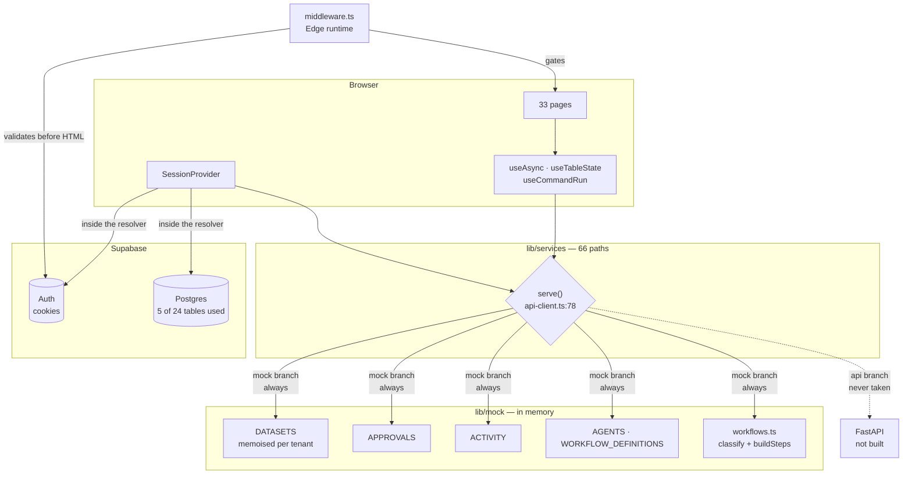

# 12 — Data flow

## The one-sentence version

Every screen reads through `serve()`; `serve()` currently answers from an
in-memory dataset generated at import time; authentication and the tenant list
are the only reads that reach Postgres.

---

## The five data sources

| # | Source | Lifetime | What comes from it |
| --- | --- | --- | --- |
| 1 | `lib/mock/*` module-level objects | Until page reload | All business records, metrics, approvals, activity, agents, workflow history |
| 2 | Supabase Postgres | Durable | `profiles`, `businesses`, `business_users`, `business_hours`, `business_capabilities` |
| 3 | Supabase Auth (cookies) | Until expiry | The session, the user, `app_metadata.role` |
| 4 | `localStorage` | Per browser | Sidebar collapsed state, theme |
| 5 | Cookies set by this app | Per browser | `aibh-active-business` |

Nothing else. There is no cache layer, no service worker, no IndexedDB, no
server-side data store other than Postgres.

---

## The single choke point

`lib/services/api-client.ts:78`. Every one of the 66 service paths goes through
it.

```ts
export async function serve<T>(
  path: string,
  resolver: () => T | Promise<T>,
  options: ServeOptions = {},
): Promise<T> {
  if (DATA_MODE === "api" && config.api.baseUrl) {
    return fetchFromApi<T>(path, options);        // ← never taken today
  }

  await sleep(options.latencyMs ?? randomLatency());

  try {
    return await resolver();                       // ← always taken
  } catch (error) {
    throw new ApiError(error instanceof Error ? error.message : "Mock resolver failed", 500, path);
  }
}
```

Read the two branches carefully, because the design of the whole application
follows from them:

- `path` is a **real REST path** (`/businesses/:id/approvals`), declared today and
  used tomorrow. It is what makes `04_API_REFERENCE.md` a specification rather
  than a wish.
- `options` carries `method`, `body`, `query`, `signal` — all ignored by the mock
  branch, all used by `fetchFromApi`. The call sites are already written for the
  real transport.
- `randomLatency()` returns 220–620 ms from `config.mockLatency`, gated on
  `config.features.simulatedLatency`. Loading skeletons therefore appear in
  development, which is why they were built correctly.
- The `catch` normalises every mock failure into an `ApiError` with status 500,
  so error handling upstream is uniform across both branches.

Path distribution: **66 paths — 47 GET, 12 POST, 7 PATCH.** No DELETE or PUT
anywhere. Nothing in this application deletes anything.

| Service module | Paths |
| --- | --- |
| `business-service.ts` | 11 |
| `operations-service.ts` | 11 |
| `admin-service.ts` | 10 |
| `workflow-service.ts` | 10 |
| `approval-service.ts` | 8 |
| `auth-service.ts` | 6 |
| `insight-service.ts` | 6 |
| `customer-service.ts` | 4 |

---

## Read path: a mock-backed screen

`/app/payments` is representative of 12 of the 15 workspace pages.

```
app/app/payments/page.tsx
  useWorkspace()                       → businessId (from session-provider)
  useTableState()                      → search, page, sort, filters
  useAsync(() => operationsService.payments(businessId, tableState), [deps])
        │
        ▼
lib/services/operations-service.ts
  serve<Paginated<Payment>>(
    `/businesses/${businessId}/payments`,
    () => paginate(datasetFor(businessId).payments, params, ["customerName","invoiceNumber"]),
    { query: {...} })
        │
        ▼
lib/services/api-client.ts:78   → sleep(220–620 ms) → resolver()
        │
        ▼
lib/mock/business-data.ts:566   datasetFor(businessId)
  DATASETS.get(key) ?? buildTenant(recipe)     ← memoised; built once per session
        │
        ▼
api-client.ts:paginate()  → search → filter → sort → slice
        │
        ▼
{ rows, total, page, pageSize } → useAsync sets data → table renders
```

Four properties of this path:

1. **The dataset is built once.** `datasetFor` memoises into a `Map`. The first
   call for a tenant runs the whole generator; every later call is a lookup. This
   is why the app feels fast despite generating ~800 appointments per tenant.
2. **`paginate()` is shared by every table**, so search, sort and paging behave
   identically across nine pages. Signature: `paginate<T>(rows, params,
   searchFields)`.
3. **Filtering happens after generation, in JS.** Against a real backend the same
   `query` object becomes URL parameters and the filtering moves into SQL — the
   indexes for it already exist (doc 11).
4. **Nothing is cached between renders.** Changing a filter re-runs the whole
   pipeline. Cheap here; it will become a network round trip later.

---

## Read path: a real, Postgres-backed screen

Only the session and the tenant list take this path.

```
app/layout.tsx → AppProviders → SessionProvider
  authService.currentSession()
        │
        ▼
lib/services/auth-service.ts
  serve("/auth/session", async () => {
     const supabase = getBrowserSupabase();
     if (!supabase) return mockSession();          ← demo mode fallback
     const { data } = await supabase.auth.getUser();
     return loadSession(supabase, data.user);
  })
        │
        ▼
lib/supabase/session.ts:41  loadSession()
  select from public.profiles  where id = user.id
  select from public.business_users join businesses
  roleFromUser(user)  ← app_metadata.role
        │
        ▼
{ user, role, businesses[] } → SessionProvider state
  → useWorkspace() gives every page its businessId
```

Note what this means structurally: **the real reads happen inside a mock-branch
resolver.** `serve()` takes its mock branch, sleeps, then the resolver makes a
genuine network call to Supabase. That is why authentication is real while
everything else is not — the seam is per-resolver, not global.

`getBrowserSupabase()` returning `null` is a supported state: with
`NEXT_PUBLIC_DEMO_MODE=1` and no Supabase URL, the app falls back to a mock
session so the UI can be demoed with no backend at all. `next.config.mjs`
enforces the pairing — it throws *"Refusing to build: Supabase is not
configured."* unless either Supabase is configured or demo mode is explicitly on.

---

## Write path

Only two kinds of write exist.

### Real writes — Supabase, 5 tables

| Operation | Function | Tables |
| --- | --- | --- |
| Create workspace | `createBusinessForUser()` `businesses.ts:153` | `businesses`, `business_users`, `business_hours`, `business_capabilities` (4 inserts, **no transaction**) |
| Update profile / settings | `updateBusinessRow()` `:251` | `businesses` |
| Toggle capability | `setCapabilityEnabled()` `:228` | `business_capabilities` |
| Touch last-seen | `touchLastActive()` `session.ts:91` | `profiles` |
| Sign up / in / out / reset | `auth-service.ts` | `auth.users` (+ `profiles` via trigger) |

### Simulated writes — in-memory mutation

| Operation | Effect | Survives reload? |
| --- | --- | --- |
| Approve / reject | `approval.status = …` on the shared `APPROVALS` array | No |
| Include / exclude an item | `item.included = …` | No |
| Edit a draft message | `item.proposedMessage = …` | No |
| Complete a run | `recordActivity()` unshifts onto `ACTIVITY` | No |
| Toggle an automation | React `useState` only | No |

These mutate module-level arrays **in place**, which has a consequence worth
knowing: the change is visible to every component that later reads the same
array, even without a refetch, because they share the object. It works, and it is
the opposite of how the real backend will behave (where a refetch is required).
Any component relying on that aliasing will need review at swap time.

---

## The mock data generator

`lib/mock/seed.ts` + `lib/mock/business-data.ts`. Two decisions define its
behaviour.

**1. A seeded PRNG.** `rngFor(seed)` returns a deterministic generator, so the
same tenant produces the same 17 overdue invoices on every reload and on every
machine. Without this, screenshots, tests and the generated `seed.sql` would all
drift. `scripts/generate-seed.ts` depends on it entirely.

**2. A single `NOW` anchor.** All timestamps are expressed as offsets
(`minutesAgo`, `hoursAgo`, `daysAgo`, `minutesFromNow`) from one captured instant.
The data therefore always looks current — "12 minutes ago", "today's
appointments" — no matter when the app is opened.

```
TENANT_RECIPES (3)
  → buildTenant(recipe)
      buildCustomers   → DraftCustomer[]
      buildPayments    → Payment[]        (uses the customers)
      enrichCustomers  → Customer[]       (outstanding, last interaction)
      buildAppointments→ Appointment[]    (respects business_hours; skips closed days)
      buildInventory   → InventoryItem[]
      buildDocuments   → BusinessDocument[] (uses the payments)
  → TenantDataset, memoised in DATASETS
```

Order matters: payments reference customers, documents reference payments,
`enrichCustomers` aggregates payments back onto customers. A change to the
customer generator ripples through everything downstream — including `seed.sql`,
which must be regenerated.

`buildAppointments` carries a constraint learned the hard way: it reads the
tenant's opening hours, skips closed days, and stops before closing time. Before
that, it generated 23 appointments running past midnight, violating the
`appointments_time_order` CHECK in Postgres. Appointment count went from 1017 to
780. Two Vitest invariants now guard it.

---

## Bridging mock data to real tenants

The awkward join in the current architecture, and worth understanding because it
is the source of the most likely runtime error.

A user who signs up gets a **real** `businesses` row with a random UUID. The mock
dataset is keyed by demo string ids (`biz_salon`, `biz_gym`, `biz_retail`). Those
do not match.

`lib/mock/demo-bridge.ts`:

| Function | Purpose |
| --- | --- |
| `registerDemoAlias(realId, datasetKey)` | Records the mapping |
| `datasetKeyFor(id)` | Resolves a real UUID to a dataset key, or returns the id unchanged |
| `clearDemoAliases()` | **Unused — no importer** |

`business-data.ts:569` calls `datasetKeyFor()` before the `DATASETS` lookup. If no
alias was registered for a real business id, the lookup misses,
`BUSINESS_INDEX.get()` returns `undefined`, and the page throws "Business not
found".

This entire module is scaffolding that disappears once `DATA_MODE=api`. It is not
a design flaw so much as the visible cost of running a real auth layer over mock
business data.

---

## Data flow diagram



---

## What changes when the backend arrives

| Today | After |
| --- | --- |
| `serve()` takes the mock branch | Takes `fetchFromApi` |
| `resolver` runs locally | Never runs; dead but harmless |
| `paginate()` filters in JS | SQL `where`/`order by`/`limit` |
| Mutations change memory | `INSERT`/`UPDATE` under RLS |
| `demo-bridge` maps ids | Deleted |
| `recordActivity()` → array | `insert into activities` |
| Errors are `ApiError(…, 500)` | Real HTTP statuses, already handled |
| **Component code** | **Unchanged** |

The last row is the payoff for the whole indirection, and it is worth protecting:
any component that imports from `lib/mock` directly breaks it.

**21 files do import from `lib/mock` directly.** Being precise about which, because
the distinction between them is the whole point:

| Import | Files | Verdict |
| --- | --- | --- |
| `capabilityMeta` from `lib/mock/capabilities` | 17 | **Acceptable.** A pure lookup over the static 9-capability catalogue (`CAPABILITY_INDEX.get(key) ?? CAPABILITIES[0]`). It is domain metadata — names, icons, descriptions — not tenant data, and it is misfiled: it belongs in `lib/domain.ts`, not `lib/mock/` |
| `CAPABILITIES` array | `app/app/activity/page.tsx`, `components/landing/sections.tsx` | Same — the static catalogue |
| `SUGGESTED_COMMANDS` | `components/layout/command-palette.tsx` | Same, static |
| **`attentionItems` from `lib/mock/metrics`** | **`components/layout/notifications.tsx:12`** | **A genuine bypass.** This is tenant data fetched outside the service layer |

That last one is the only real violation, and it is explicit about it
(`notifications.tsx:22-29`):

```ts
const { data, loading } = useAsync(
  async () => {
    await sleep(180);                    // hand-rolled latency, no serve()
    return attentionItems(businessId);   // straight into lib/mock
  },
  [businessId],
  { enabled: Boolean(businessId) },
);
```

It has no `serve()` path, so it appears in none of the 66 declared endpoints, and
it will not follow the rest of the app to the real backend. The notification tray
will silently keep showing mock data after the swap. Recorded in
`32_UNKNOWN_BROKEN_INCOMPLETE.md`; the fix is a `serve()` path in
`insight-service.ts` beside the overview's attention feed, which reads the same
function.

---

## Related documents

- `04_API_REFERENCE.md` — all 66 paths
- `11_DATABASE_ARCHITECTURE.md` — the tables behind the real reads
- `14_BACKEND_ARCHITECTURE.md` — what does and does not run on a server
- `25_PERFORMANCE_ARCHITECTURE.md` — cost of generating the dataset
