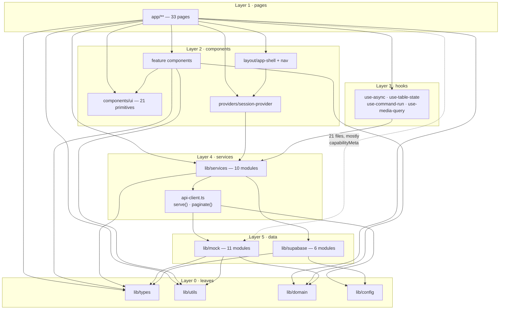

# 20 — Code dependency map

Measured, not guessed. Counts come from parsing every `from "…"` in all 152
`.ts`/`.tsx` files (plus `middleware.ts`), resolving `@/` and relative paths, and
counting distinct importing files per target.

---

## Most-imported modules

| Importers | Module | What it is |
| --- | --- | --- |
| **92** | `lib/utils` | `cn`, `formatCurrency`, `formatDate`, `formatClock`, `relativeTime`, `initials`, `sleep`, `pluralize` |
| 59 | `lib/types` | Every domain type |
| 47 | `components/ui/button` | |
| 43 | `components/ui/badge` | |
| 41 | `components/ui/skeleton` | Every page has a loading state |
| 40 | `lib/domain` | `BUSINESS_TYPES`, `vocabulary()`, status→tone maps |
| 37 | `lib/services` | The barrel — how pages reach data |
| 32 | `components/ui/status` | `StatusDot`, `StatusBadge` |
| 30 | `lib/hooks/use-async` | |
| 29 | `lib/mock/capabilities` | The 9-capability catalogue |
| 27 | `components/layout/app-shell` | |
| 26 | `components/providers/session-provider` | `useSession`, `useWorkspace` |
| 25 | `components/layout/page-header` | |
| 21 | `components/ui/states` | Empty / error states |
| 19 | `components/ui/toaster` | |
| 16 | `lib/mock/businesses` | `BUSINESS_INDEX` |
| 13 | `lib/config` | |
| 10 | `lib/services/api-client` | `serve`, `paginate`, `ApiError` |
| 9 | `lib/mock/business-data` | The generator + query functions |
| 8 | `lib/mock/seed`, `lib/mock/approvals`, `lib/hooks/use-table-state` | |
| 7 | `lib/supabase/config` | |
| 6 | `lib/navigation`, `lib/mock/activity` | |
| 5 | `lib/mock/metrics` | |
| 4 | `components/charts/chart-kit` | |

**`lib/utils` at 92 importers is the highest-risk module in the codebase.** A
breaking change there touches nearly every file. It is also the one with the most
test coverage (23 assertions) — appropriately.

`lib/types` at 59 and `lib/domain` at 40 are the other two chokepoints. All three
are leaf modules with no internal dependencies, which is why they can be that
widely imported without creating cycles.

---

## Layer graph



Layer 0 is imported by everything and imports nothing but itself. That is why the
graph has no cycles.

The dotted edge is the one layering violation, detailed below.

---

## Dependency rules — kept and broken

| Rule | Held? |
| --- | --- |
| Pages never import `lib/supabase` directly | **Kept** — only `session-provider` and the services do |
| Components never call `fetch` | **Kept** — the only `fetch` is in `api-client.ts` |
| Services never import components | **Kept** |
| `lib/mock` never imports `lib/services` | **Kept** — the dependency points one way |
| `lib/mock` never imports React | **Kept** — it is pure data, which is why `scripts/generate-seed.ts` can import it in Node |
| No component imports `lib/mock` | **Broken, 21 files** |
| Nothing reads `process.env` outside `lib/config` | **Broken, 3 files** — `lib/supabase/config.ts`, `next.config.mjs`, and `lib/config.ts` itself |

### The 21 `lib/mock` importers, classified

| What is imported | Files | Verdict |
| --- | --- | --- |
| `capabilityMeta` | 17 | Acceptable — a pure lookup over a static catalogue. **Misfiled**: this is domain metadata and belongs in `lib/domain.ts` |
| `CAPABILITIES` | 2 (`app/app/activity`, `components/landing/sections`) | Same |
| `SUGGESTED_COMMANDS` | 1 (`components/layout/command-palette`) | Same |
| **`attentionItems`** | 1 (`components/layout/notifications`) | **A genuine bypass** — tenant data fetched outside `serve()` |

Moving `capabilities.ts` from `lib/mock/` to `lib/domain/` would resolve 20 of the
21 in one commit and change no behaviour. The 21st needs a `serve()` path.

### The `process.env` reads

`lib/supabase/config.ts` reading them directly is **correct, not a violation**:
`middleware.ts` runs on the Edge before `lib/config`'s larger object would be
useful, and the two Supabase values must be available there. `next.config.mjs`
reads them at build time by necessity.

---

## The critical dependency chains

### The command run — 9 hops

```
app/app/command/page.tsx
  → lib/hooks/use-command-run
    → lib/services (barrel)
      → lib/services/workflow-service
        → lib/services/api-client        [serve()]
          → lib/config                   [DATA_MODE]
        → lib/mock/workflows             [planCommand, buildRun]
          → lib/mock/business-data       [overduePayments, appointmentsOn, …]
            → lib/mock/seed              [rngFor, minutesAgo]
          → lib/mock/approvals           [approvalsFor]
          → lib/domain                   [vocabulary]
```

Nine modules for one command. Every one is required, and swapping the backend
replaces only the two `lib/mock/workflows` entry points.

### The session — 7 hops

```
app/layout.tsx
  → components/providers/app-providers
    → components/providers/session-provider
      → lib/services/auth-service
        → lib/supabase/client            [getBrowserSupabase]
          → lib/supabase/config          [SUPABASE_URL, ANON_KEY]
        → lib/supabase/session           [loadSession, roleFromUser]
      → lib/services/business-service
        → lib/supabase/businesses        [fetchBusinesses]
```

### The guard — 3 hops, and the shortest chain in the app

```
middleware.ts
  → lib/supabase/config      [isGuardedPath, isSupabaseConfigured]
  → lib/supabase/middleware  [updateSession, redirectWithSession]
    → @supabase/ssr
```

Deliberately short: middleware runs on the Edge runtime, where the bundle is
size- and API-constrained. Pulling `lib/config` or anything touching React into
this chain would be a mistake.

---

## Circular dependencies

**None.** Verified by the layer structure: Layer 0 (`types`, `utils`, `domain`,
`config`) imports only from Layer 0, and each higher layer imports only downward.

Two near-misses worth knowing:

1. `lib/mock/capabilities` ← `lib/mock/businesses` ← `lib/mock/business-data` —
   a chain within one folder, but strictly one-directional.
2. `lib/services/index.ts` is a barrel re-exporting all nine services. A service
   importing the barrel instead of a sibling directly would create a cycle. None
   does; keep it that way.

---

## Unused exports

Found by cross-referencing every export against every import.

| Export | File | Note |
| --- | --- | --- |
| `getServerSupabase`, `getServerUser`, `getActiveBusinessId` | `lib/supabase/server.ts` | **The whole module is unused** — no server component or route handler exists |
| `clearDemoAliases` | `lib/mock/demo-bridge.ts` | Written for test teardown; no test uses it |
| `isBackendConnected` | `lib/config.ts` | Used once, by `app/admin/settings/page.tsx` — so *technically* used, but for display only |

A previous pass already pruned a duplicate RNG in `lib/utils.ts`, several unused
aggregate exports, `AGENT_INDEX`, `DEMO_BUSINESSES`, `capabilityForCommand` and
`availableCapabilities`. The three above are what remains, and all three are
deliberate scaffolding for the next phase rather than dead weight.

---

## External dependencies

31 runtime, 13 dev. Full list in `18_CONFIGURATION.md`.

| Package | Imported by | Coupling |
| --- | --- | --- |
| `react`, `react-dom` | everything | Total |
| `next` | pages, middleware, metadata routes | Total |
| 16 × `@radix-ui/*` | `components/ui/*` only | **Well isolated** — swapping a primitive touches one file |
| `lucide-react` | ~everywhere | High, but icons are trivially replaceable |
| `recharts` | `components/charts/chart-kit.tsx` **only** | **Excellent** — one file to change |
| `@supabase/supabase-js`, `@supabase/ssr` | `lib/supabase/*` only | **Well isolated** — 6 files |
| `clsx` + `tailwind-merge` | `lib/utils.ts` only, via `cn` | Excellent |
| `class-variance-authority` | `components/ui/*` | Isolated |
| `sonner` | `components/ui/toaster.tsx` only | Excellent |
| `cmdk` | `components/ui/command.tsx` only | Excellent |
| `next-themes` | `components/providers/theme-provider.tsx` only | Excellent |
| `date-fns` | `lib/utils.ts` + a few components | Low |

The isolation discipline is real: **five of the twelve external libraries are
imported by exactly one file each.** Recharts being confined to `chart-kit.tsx`
is the clearest example — replacing the charting library is a single-file change,
which is unusual and worth preserving.

---

## Change-impact reference

Before editing, know what you are touching:

| Change to… | Files affected | Risk |
| --- | --- | --- |
| `lib/utils.ts` | 92 | **Highest.** Run `npm run verify` |
| `lib/types.ts` | 59 | High — but TypeScript catches every break at compile time |
| `lib/domain.ts` | 40 | High — vocabulary changes ripple into every screen's wording |
| `components/ui/button.tsx` | 47 | Visual only |
| `lib/services/api-client.ts` | 10 direct, **all 66 paths** | **Highest for behaviour.** Every screen's data flows through `serve()` |
| `lib/mock/workflows.ts` | 6 | Contained — but it is the whole simulated AI |
| `lib/supabase/*` | 7–22 | The auth path. Break it and nobody signs in |
| `middleware.ts` | 0 importers | **Security-critical despite that.** Nothing imports it; Next invokes it |
| A `supabase/migrations/*.sql` file | 0 code files | But 98 assertions in `migrations.test.ts` and the pgTAP suite will fail |
| `app/globals.css` tokens | 0 imports | **Every page visually** |

`middleware.ts` is the trap on that list: zero importers, so nothing tells you it
matters, and it is the only thing standing between an anonymous request and the
workspace.

---

## Related documents

- `19_CODEBASE_FILE_GUIDE.md` — every file
- `12_DATA_FLOW.md` — the runtime path through these layers
- `26_CODE_QUALITY_AUDIT.md` — the misfiled catalogue and other findings
- `31_MODIFICATION_GUIDE.md` — how to change things safely
