# AI Business Hub — the whole project explained

*Your business. Your AI workforce.*

No code in this document. Diagrams, tables, screen sketches and plain language
only. If you want file names, function names and line numbers, read documents
`00`–`34` in this folder instead.

**About the diagrams and images.** Every diagram below is a Mermaid diagram. It
renders as a real picture automatically in GitHub, GitLab, VS Code (with the
Markdown Preview Mermaid extension), Notion, Obsidian and most Markdown viewers.
No external image files are embedded, because there are none in this project —
inventing screenshots of screens that have never been photographed would be
making things up, so instead the screen layouts are drawn as labelled text
sketches you can compare against the running app.

**Two markers are used throughout:**

| Marker | Meaning |
| --- | --- |
| ● | **Working today.** You can do this in the running application |
| ○ | **Designed, not yet built.** The screens, the data shapes and the database tables exist; the engine behind them does not |

That distinction is kept honest on purpose. A document that describes the
finished vision as though it already runs would be useless to anybody who has to
build the rest of it.

---

# Part 1 · What this is

## The one-paragraph version

AI Business Hub is a web application that a small business signs into to run the
admin work nobody has time for. The owner types a request in ordinary English —
*"find who hasn't paid and prepare reminders"* — and the system works through it
in front of them: it finds the unpaid bills, pulls up each customer, writes a
personal message for each one, and then **stops and asks the owner to approve
before a single message is sent.** The same application serves a salon, a gym, a
garage, a coaching centre or a water purifier shop; it changes its vocabulary and
switches different powers on rather than becoming a different product.

## What it is not

- **Not a chatbot.** You do not have a conversation with it. You give it a job
  and it shows you the work.
- **Not a generic admin dashboard.** The dashboard exists, but the point is the
  work getting done, not the charts.
- **Not an autopilot.** Anything that touches a customer or money stops for a
  human decision, by design.

## The problem it exists to solve

Every small business in India has the same invisible backlog. Not the work the
owner is paid for — the work *around* it:

| The real daily problem | Why it never gets done |
| --- | --- |
| Eleven customers owe money | Chasing them is awkward, slow, and there is always a customer in front of you |
| Tomorrow's bookings are unconfirmed | Twelve phone calls at 8pm after a twelve-hour day |
| A service is due for forty customers this month | It lives in a diary, a WhatsApp chat and someone's memory |
| Nine customers have not returned in four months | Nobody noticed. A competitor did |
| Two filters and a lamp are nearly out of stock | You find out when a technician is standing in someone's kitchen |
| Six invoices are still not written | The GST filing is next week |
| Four missed calls while you were on a site visit | Those were four new customers. They called the next shop |

None of it is difficult. All of it is repetitive, all of it is time-sensitive, and
all of it is last on the list. **That backlog is the product's target.** It is
also, not coincidentally, exactly the kind of work that is a good fit for AI: high
volume, low judgement, clear inputs, and easy to check before it goes out.

## Why the human approval step is the most important design decision

An AI that sends messages to your customers without asking is not a helper, it is
a liability. One wrong payment reminder to a customer who already paid costs more
goodwill than ten correct reminders earn.

So the system is built the other way round:

> **The AI does the work. The human makes the decision.**

Everything the AI prepares is shown as a reviewable batch — every customer, every
amount, every draft message — with a switch beside each one and an edit box for
the wording. The owner can approve all of it, remove three of them, reword one,
or reject the lot. Nothing leaves until they say so.

This is why the product can plausibly be trusted with a real customer list, and
it is the single feature that separates it from "let the AI handle it".

---

# Part 2 · Who uses it

Three audiences. Only two of them ever sign in.

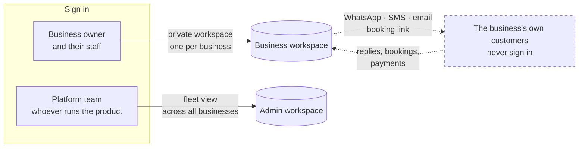

## Roles inside one business ●

There are three roles — **owner**, **manager** and **staff**. What each can do
today, exactly as the database enforces it:

| | Owner | Manager | Staff |
| --- | --- | --- | --- |
| See the workspace, customers, bookings, invoices, stock | ✔ | ✔ | ✔ |
| Change business settings and opening hours | ✔ | ✔ | ✘ |
| Delete an issued document | ✔ | ✔ | ✘ |
| Invite or remove a team member | ✔ | ✘ | ✘ |
| **Approve an action that reaches a customer** | ✔ | ✔ | **✔ — see below** |

The staff restrictions that exist are well chosen: a staff account that gets
compromised cannot make issued invoices disappear, cannot change the business's
settings, and cannot add another account to the business.

> **One gap worth naming.** The approval gate itself has **no role restriction**.
> Any member of the business — including a staff account — can approve a batch of
> messages going out to two hundred customers. Every other role rule is enforced
> in the database; this one was never added. Given that approval is the single
> control standing between the AI and a business's customers, it should be
> restricted to owner and manager, and the mechanism to do it already exists and
> is already used by three other rules. This is listed in
> `32_UNKNOWN_BROKEN_INCOMPLETE.md`.

## The platform team's role, and its deliberate blind spot ●

The platform team can see, across every business: how many are active, which
capabilities are switched on, how many approvals are waiting, and the activity
trail of what the AI has been doing.

They **cannot** see any business's customers, their phone numbers, their
appointments, their invoices, or the contents of an approval batch.

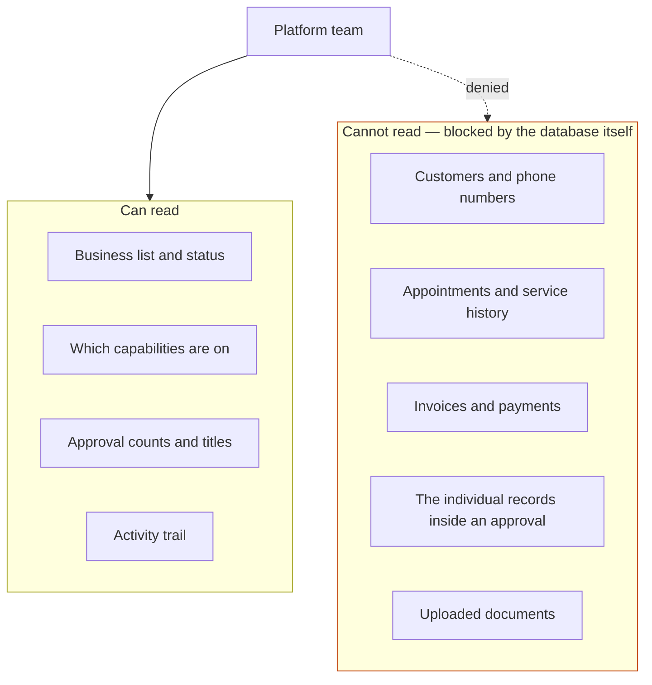

The practical version: a platform engineer can see that *"Aqua Fresh has 23
payment reminders waiting for approval"* and use that to help them. They cannot
see that one of those 23 is Mrs Sharma in Kukatpally who owes ₹1,450. That line
is enforced by the database, not by the screens — so a bug in the application
cannot cross it.

---

# Part 3 · The two big ideas

Everything else in the product follows from these two.

## Idea 1 · Capabilities — powers you switch on, not features you configure ●

A business does not set up "modules". It chooses which **capabilities** its AI
workforce has. There are nine, and they are deliberately generic so the same nine
serve every industry.

| Capability | In plain words | Needs approval before acting? |
| --- | --- | --- |
| **Customer support** | Answer questions arriving from customers, escalate anything sensitive | Above thresholds |
| **Appointments** | Fill the diary, confirm bookings, handle reschedules | Above thresholds |
| **Payment follow-up** | Find who owes money, chase it politely, send payment links | **Always** |
| **Customer follow-up** | Notice who has gone quiet and win them back | **Always** |
| **Communication** | Write and send messages in the business's own voice | **Always** |
| **Reminders** | Nudge people before a due date | **Always** |
| **Inventory** | Watch stock, propose reorders | Above thresholds |
| **Documents** | Create invoices, quotes, receipts | **Always** |
| **Reports** | Summarise the day, the week, the money | Never — it only reads |

When a business signs up and says what kind of business it is, a sensible set is
pre-selected. A garage or workshop gets **Appointments, Documents, Payment
follow-up, Inventory and Reminders**. A retail store gets **Inventory, Customer
support, Payment follow-up, Documents and Reports**. The owner can change any of
it, then or later.

Switching a capability on or off has visible effects immediately ●: the navigation
menu changes, and the suggestions offered in the command box change. You cannot
be offered "chase overdue payments" if you have not switched payment follow-up on.

## Idea 2 · One product, many industries ●

The twelfth and most important product rule is: **never hardcode the interface to
one industry.** It is implemented by giving every business type its own
vocabulary, and routing every noun the product shows through it.

| Business type | A customer is called | A booking is called | Staff are called | Stock is called |
| --- | --- | --- | --- | --- |
| Salon & Spa | Customer | Appointment | Stylist | Stock |
| Gym & Fitness | **Member** | **Class** | Trainer | Stock |
| Retail Store | Customer | **Order** | Associate | Stock |
| Restaurant & Café | **Guest** | **Reservation** | Host | Stock |
| Garage & Workshop | Customer | **Service job** | **Technician** | **Parts** |
| Coaching Centre | **Student** | **Session** | Faculty | Stock |
| Laundry & Dry Clean | Customer | **Pickup** | Operator | Stock |
| Real Estate | **Client** | **Site visit** | Agent | Stock |
| Something else | Customer | Appointment | Team member | Stock |

The effect: a gym owner types *"show me today's schedule"* and the system replies
*"Today's classes — 14 classes, 3 unconfirmed"*. A garage owner types the same
words and gets *"Today's service jobs"*. Same engine, same code, different words.
Six currencies are supported — Indian Rupee, US Dollar, Euro, British Pound, UAE
Dirham and Sri Lankan Rupee — with the Rupee as the default, and money is
formatted in the Indian lakh/crore scale rather than millions.

---

# Part 4 · The AI workforce

## The roster — eleven agents

One supervisor and ten specialists. The supervisor understands the request and
decides who does what; each specialist does one kind of work and holds the tools
for it.

| Agent | Its job | Its tools | Model tier |
| --- | --- | --- | --- |
| **Supervisor** | Understand the request, choose the specialists, decide where a human must approve | Agent registry, business configuration, approval policy | Most capable |
| **Support Agent** | Answer customer enquiries from the business's own information; escalate anything it should not decide | Knowledge base, WhatsApp, customer records | Standard |
| **Booking Agent** | Find slots, book, reschedule, release unclaimed slots | Booking calendar, Google Calendar, staff roster | Standard |
| **Payment Agent** | Reconcile the invoice ledger, rank who owes what and for how long | Invoice ledger, Razorpay, UPI collections | Standard |
| **Customer Agent** | Know each customer — history, preferred channel, tone, whether they are on a payment plan | Customer records, interaction history, segmentation | Standard |
| **Communication Agent** | Write the actual message, one per customer, in the business's voice | WhatsApp, SMS, email, tone profile | Standard |
| **Inventory Agent** | Watch stock against reorder levels, propose purchase orders | Stock ledger, supplier directory | Fast / cheap |
| **Reporting Agent** | Summarise the day, the money, the trends | Business data, chart renderer | Standard |
| **Document Agent** | Produce invoices, quotes, receipts with the right tax details | Invoice ledger, tax profile, document storage | Standard |
| **Reminder Agent** | Schedule and send nudges before a due date | Scheduler, WhatsApp, SMS | Fast / cheap |
| **Voice Agent** | Answer inbound phone calls | Telephony bridge | **Not yet assigned** |

Three tiers of model are used on purpose: the most capable model for the
supervisor, which has to reason about intent; a standard model for the
specialists; and a fast, cheap model for the high-volume, low-judgement work
(reminders, stock checks). That keeps cost proportionate to the difficulty of the
job.

## The organisation chart

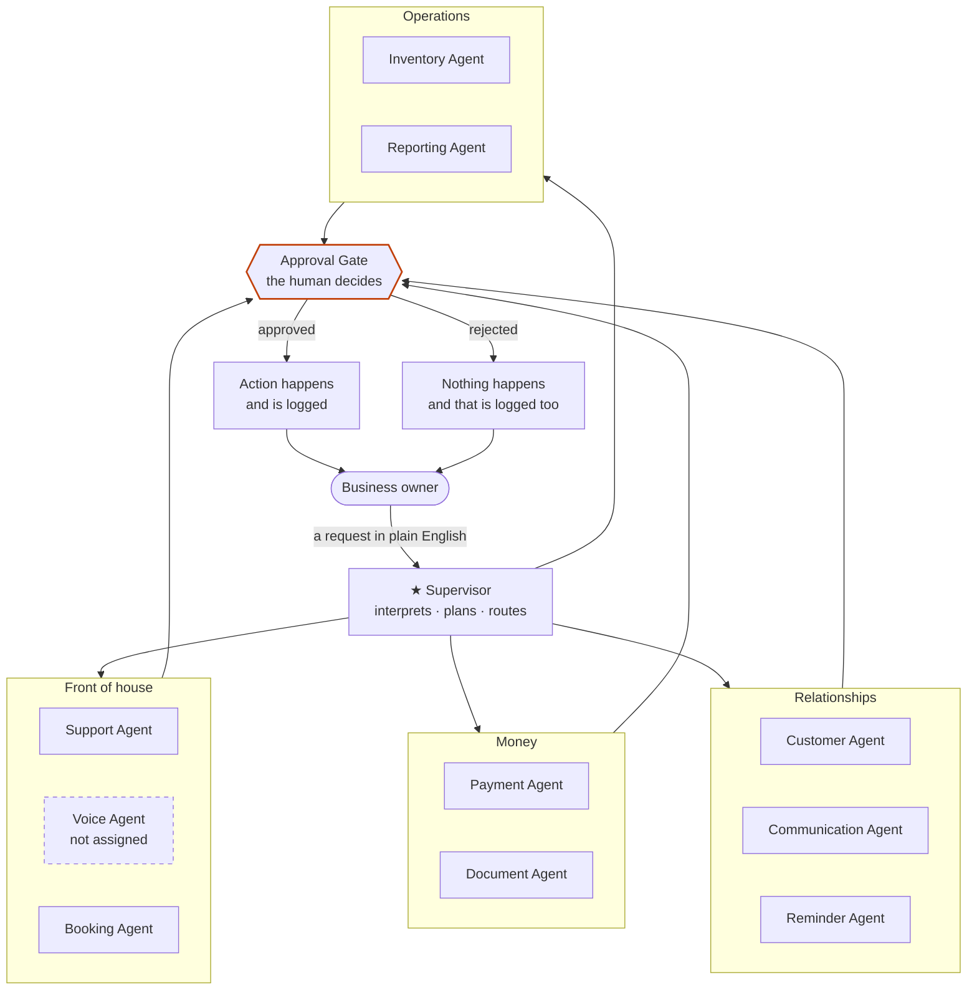

Note that the **Approval Gate is not an agent.** It is a stop in the pipeline. It
is drawn in the same diagram as the agents because on screen it appears in the
same timeline as their work — which is the point. The pause is visible, not
hidden.

## How the agents communicate with each other

This is the part most worth being precise about.

### The design ○

Agents do **not** chat with one another. There is no group conversation, no
negotiation, no agent deciding to call another agent. The pattern is a
**supervisor with a shared worksheet**:

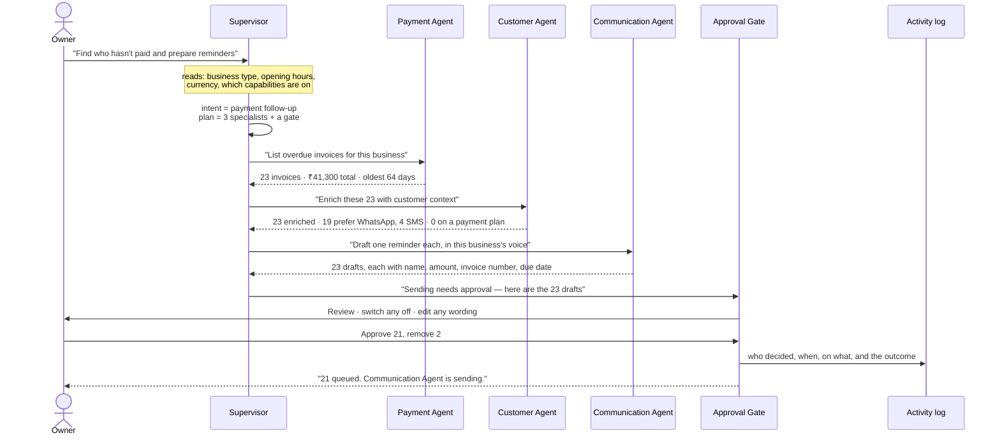

Four rules make that pattern work:

1. **Only the supervisor talks to specialists.** A specialist never calls another
   specialist. This keeps the chain traceable — for any result you can say
   exactly which agent produced it and what it was given.
2. **They pass structured findings, not conversation.** The Payment Agent hands
   back a list of invoices, not a paragraph. The Customer Agent adds fields to
   those rows. The Communication Agent adds a message to each row. The
   worksheet grows; nothing is re-interpreted from prose at each hop.
3. **Every hand-off is visible on screen** as a step, with what it found. The
   owner is not told to trust it; they are shown the numbers.
4. **The gate is not optional and not a suggestion.** It is a step in the
   sequence. Work stops there.

### What actually happens today ●

The screens above are real and you can watch the whole sequence run. What is
behind them is not an AI:

- The request is matched against **keyword lists** to pick one of nine intents.
  Words like *overdue*, *payment*, *reminder* score towards payment follow-up;
  longer, more specific phrases outrank single words.
- The sequence of steps for each intent is **written out in advance**, not
  decided by a model.
- **The numbers in every step are real.** When the screen says 23 overdue
  invoices totalling ₹41,300, it counted the actual invoices in that business's
  data. This is why the demonstration is convincing rather than a mock-up.
- Each step then appears on a **timer** — roughly half a second each — so the
  work reads as work rather than a page load.
- The approval batch is real, reviewable, editable and decidable ●. What is
  missing is the last mile: **after approval, nothing sends.** There is no
  messaging channel connected.

So the honest summary is: **the workforce is designed, the choreography is
designed, the review-and-approve mechanism works, and the two ends — the AI
brain and the sending hand — are the parts still to be built.** Everything
between them is finished and correct.

---

# Part 5 · How input is given

Eight ways in, of which four work today.

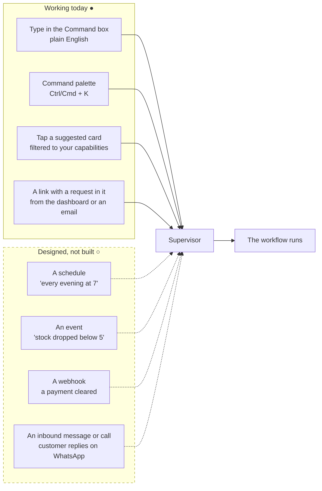

## The command box, as it appears on screen ●

```
┌──────────────────────────────────────────────────────────────────┐
│  What should your AI workforce do?                               │
│  ┌────────────────────────────────────────────────────────────┐  │
│  │ Find who hasn't paid and prepare reminders_                │  │
│  └────────────────────────────────────────────────────────────┘  │
│                                          [ Attach ]  [ Run  ↵ ]  │
└──────────────────────────────────────────────────────────────────┘

  Suggested for you                    ← only capabilities you enabled
  ┌───────────────────────────┐  ┌───────────────────────────┐
  │ ₹  Chase overdue payments │  │ 📅 Confirm tomorrow's     │
  │    23 accounts · ₹41,300  │  │    service jobs · 9 open  │
  └───────────────────────────┘  └───────────────────────────┘
  ┌───────────────────────────┐  ┌───────────────────────────┐
  │ 📦 Reorder low stock      │  │ 📊 Today's summary        │
  │    4 items below level    │  │    money in, jobs done    │
  └───────────────────────────┘  └───────────────────────────┘
```

The suggestion cards already carry real counts, so an owner can see there is
something worth doing before they ask.

## The nine things it understands ●

| Say something like | It understands | Needs approval |
| --- | --- | --- |
| "find overdue payments", "who hasn't paid" | Payment follow-up | Yes |
| "show today's schedule", "what's on today" | Schedule view | No |
| "confirm tomorrow's bookings" | Booking confirmation | Yes |
| "who hasn't come back", "win back customers" | Customer follow-up | Yes |
| "how did we do this week", "business summary" | Report | No |
| "what's running low", "stock levels" | Inventory | No |
| "any new enquiries", "unanswered messages" | Support triage | No |
| "raise invoices for completed work" | Documents | Yes |
| anything it does not recognise | Falls back to a short menu of what it *can* do | No |

An unrecognised request does not error and does not guess. It answers with what
it is able to do — which is the right behaviour for a tool a non-technical owner
is using for the first time.

---

# Part 6 · The workflow of the system, end to end

## The seven stages

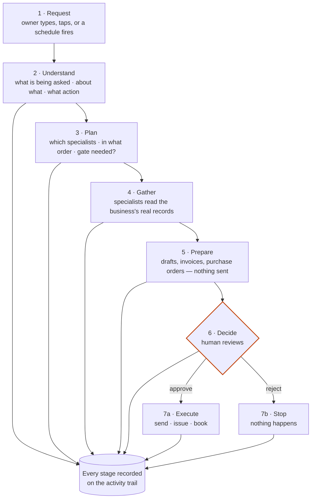

Stages 1–6 work today ●. Stage 7a is the gap ○.

## What the owner actually sees while it runs ●

```
  Your request                    Payment follow-up · always asks before sending
  "Find who hasn't paid and prepare reminders"

  ✓  Understanding your request                            Supervisor
     Intent: Payment follow-up
     Scope:  Customers with overdue invoices
     Action: Prepare reminder messages

  ✓  Planning workflow                                     Supervisor
     Agents:   Payment · Customer · Communication
     Approval: Required before send

  ✓  23 overdue customers found                        Payment Agent
     Overdue accounts   23
     Total overdue      ₹41,300
     Oldest             64 days
     ┌──────────────────────────────────────────────────┐
     │ Ramesh Kumar      INV-2291   ₹2,400   64 days    │
     │ Lakshmi Devi      INV-2310   ₹1,450   47 days    │
     │ Syed Irfan        INV-2334   ₹3,200   31 days    │
     │ … 20 more                                        │
     └──────────────────────────────────────────────────┘

  ✓  Customer information retrieved                   Customer Agent
     Records enriched    23
     Preferred channel   WhatsApp for 19 · SMS for 4
     Excluded            0 on a payment plan

  ✓  23 reminder messages prepared              Communication Agent
     Messages drafted    23
     Channel             WhatsApp Business
     Send window         Staggered over 20 minutes

  ⏸  Sending messages requires your approval           Approval Gate
     Records affected    23
     Value chased        ₹41,300
     Policy              Always ask me

        [ Review the 23 drafts ]      [ Approve and send ]
```

Two details in that screen are the whole product philosophy:

- **"Nothing was sent"** is implicit but absolute. The run stopped. The button
  says *Approve and send*, not *Undo*.
- **Every claim is checkable.** 23 accounts, ₹41,300, 64 days, and the first
  three rows are shown by name. The owner is never asked to trust a total.

## The review screen ●

```
  Payment reminders · 23 records · ₹41,300              [ Reject ] [ Approve ]

  ☑  Ramesh Kumar        ₹2,400   INV-2291 · 64 days overdue   WhatsApp
     ┌────────────────────────────────────────────────────────────────┐
     │ Hi Ramesh, a gentle reminder from Aqua Fresh: invoice INV-2291 │
     │ for ₹2,400 was due on 8 July. You can pay by UPI or at the     │
     │ shop. Thank you!                                    [ Edit ]   │
     └────────────────────────────────────────────────────────────────┘

  ☑  Lakshmi Devi        ₹1,450   INV-2310 · 47 days overdue   WhatsApp
  ☐  Syed Irfan          ₹3,200   INV-2334 · 31 days overdue   SMS
        ↑ switched off — owner knows he paid cash yesterday

  … 20 more
```

Per record: include or exclude it, and edit the wording. The batch total updates
as records are switched off. This is the mechanism that makes "AI writes to my
customers" acceptable to a real business owner.

## The status lifecycle

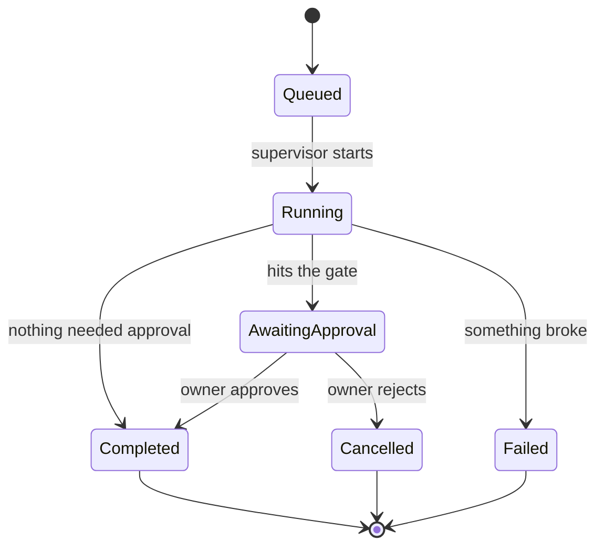

Every one of those transitions writes a line to the activity trail, with who or
what caused it.

---

# Part 7 · How data flows

## The layered picture

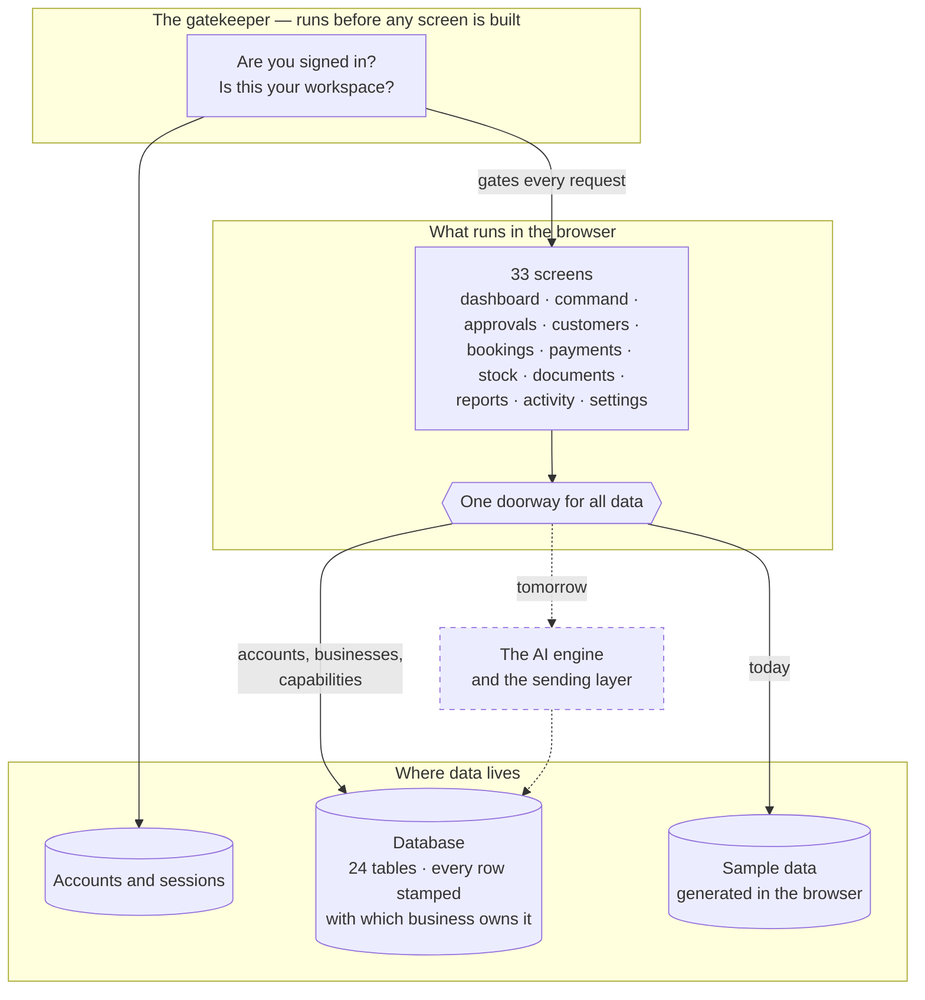

## The single doorway, and why it matters

Every screen asks for data the same way. One decision point then decides where
that data comes from: sample data generated in the browser, or a real backend
service.

Today it is sample data. When the real service exists, **that one decision point
changes and not a single screen changes.** Sixty-six data requests are already
named and typed — "the payments for this business", "the approvals waiting",
"start this command" — so the backend has a written specification to build
against rather than a blank page.

This is the most valuable structural property of the project and the reason the
remaining work is measured in weeks rather than a rewrite.

## What is durable and what is not, today

| Data | Where it lives | Survives closing the browser? |
| --- | --- | --- |
| Your account and password | Accounts service | ● Yes |
| Your session | A cookie | ● Yes |
| Your business, its hours, its capabilities | Database | ● Yes |
| Who belongs to which business | Database | ● Yes |
| Which workspace you were last in | A cookie | ● Yes |
| Light or dark theme, sidebar collapsed | Browser storage | ● Yes |
| Customers, invoices, bookings, stock, documents | Generated in the browser | ○ No |
| Approval decisions | In memory | ○ No |
| The activity trail | In memory | ○ No |

The database tables for all nine rows exist and are correctly designed. Five of
the twenty-four are actually being written to.

## Why the sample data is convincing

It is not random and it is not hand-typed. It is generated from a fixed seed, so
the same business always produces the same 23 overdue invoices on every reload
and on every machine, and the pieces are internally consistent:

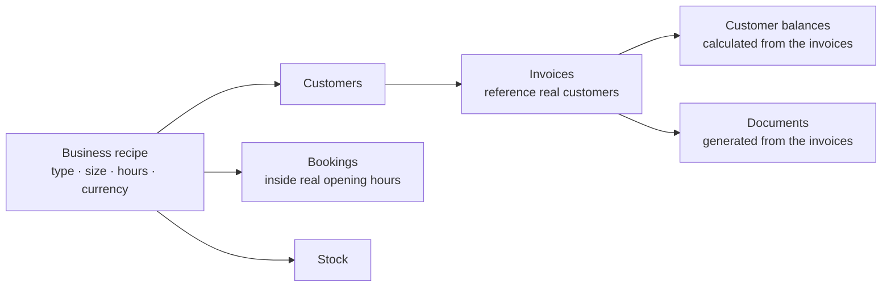

So an invoice belongs to a customer who exists, that customer's outstanding
balance is the sum of their unpaid invoices, and a booking is never scheduled on
a day the business is closed. All timestamps are relative to now, so the data
always looks like today.

---

# Part 8 · Tools and how everything is connected

## What "tool" means here

A tool is something an agent can use: a place to read business records from, or a
channel to act through. Reading tools are what make the AI's claims true.
Acting tools are what make the work actually happen.

| Tool | Used for | Read or act | State |
| --- | --- | --- | --- |
| Invoice ledger | Who owes what, for how long | Read | ● Reads real records |
| Customer records | Contact details, history, preferences | Read | ● Reads real records |
| Booking calendar | Today's and tomorrow's jobs, free slots | Read | ● Reads real records |
| Stock ledger | Quantities against reorder levels | Read | ● Reads real records |
| Business configuration | Hours, currency, vocabulary, capabilities | Read | ● Real |
| Approval policy | Whether this action needs a human | Read | ● Works (as a fixed rule per action type) |
| Activity log | Recording what was done | Act | ● Records, but only in memory |
| **WhatsApp Business** | The main customer channel in India | Act | ○ Not connected |
| **SMS (Twilio)** | Fallback when there is no WhatsApp | Act | ○ Not connected |
| **Email (Resend)** | Invoices, reports, documents | Act | ○ Not connected |
| **Razorpay / UPI** | Payment links and reconciliation | Act | ○ Not connected |
| **Stripe** | Card payments for international billing | Act | ○ Not connected |
| **Google Calendar** | Two-way sync with the team's calendar | Act | ○ Not connected |
| **Accounting (Tally / Zoho Books)** | Push issued invoices into the books | Act | ○ Not connected |
| **Telephony** | Answering inbound calls | Act | ○ Not started |
| Document storage | Private per-business file store | Act | ○ Storage exists, nothing uploads yet |
| Knowledge base | The business's own information, for answering questions | Read | ○ Does not exist |

Every reading tool works. **No acting tool is connected.** That is the single
sentence that describes what is left to build.

## The connection map

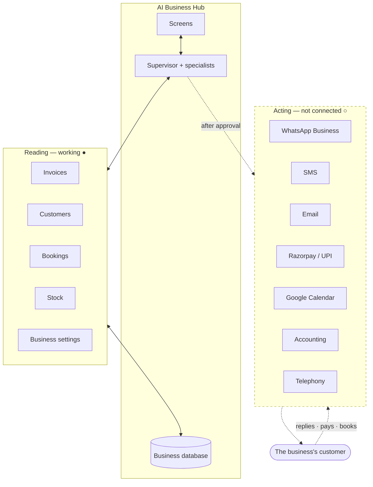

## Per-business credentials, not platform-wide

An important design point: each business connects **its own** WhatsApp number,
its own Razorpay account, its own calendar. Messages to Aqua Fresh's customers
come from Aqua Fresh's number, not from a platform number. The database is
already shaped for this — there is a per-business integrations table waiting for
it.

---

# Part 9 · Keeping each business's data private

This matters more than any feature, because one leak ends the product.

## Three independent walls ●

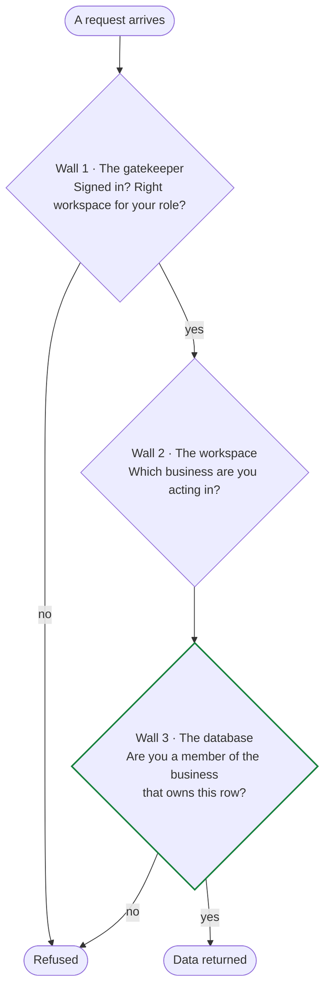

Wall 1 runs **before any page is built**, so an unauthenticated request never
receives a workspace page at all — not even one that would redirect. Wall 2 keeps
the active business straight while you switch between workspaces. Wall 3 is the
one that actually matters: **the database itself refuses.**

Every table that holds business data carries a stamp saying which business owns
each row, and fifty rules check membership before returning anything. A mistake
in the application cannot leak one business's customers to another, because the
application is not the thing enforcing it. This is tested by creating two
businesses and two users and proving that user A gets **zero** rows belonging to
business B.

## The audit trail is permanent ●

Records of what the AI did, and what humans approved, **cannot be edited or
deleted by anybody** — not by the owner, not by the platform team, not even by
the highest-privilege database account. New lines can be added; existing lines
cannot be changed or removed.

The reason is simple: if the AI sends something a customer disputes, the record
of what was sent, who approved it and when has to be trustworthy. An audit trail
that can be quietly rewritten is not an audit trail.

The same rule applies to an approval decision. Once you have approved or
rejected something, that decision is frozen.

---

# Part 10 · A real business — Aqua Fresh Water Solutions, Hyderabad

Now the whole thing applied to one business, in detail.

## The business

**Aqua Fresh Water Solutions** — a water purifier sales and service shop in
Kukatpally, Hyderabad.

> **This business is an illustration, not data in the application.** The three
> businesses actually seeded in the product today are Sri Lakshmi Salon, FitZone
> Gym and MetroMart Retail. Aqua Fresh is used here to show how the same nine
> capabilities and eleven agents map onto a trade the product was never
> specifically built for — which is the real test of the design. Every number in
> this section is a realistic figure for a shop this size, not a reading taken
> from the app.

| | |
| --- | --- |
| Owner | Venkat Rao, runs it with his wife |
| Staff | 2 service technicians (Mahesh, Imran) and one person at the counter |
| What they sell | RO purifiers — domestic and commercial — plus filters, membranes, UV lamps, pumps |
| What they service | ~600 installed units across Kukatpally, Miyapur and KPHB |
| Recurring revenue | Annual Maintenance Contracts (AMC) — ₹2,500 to ₹4,500 a year |
| Routine work | Filter change every 6 months, membrane every 2 years, UV lamp every year |
| Currency | ₹ INR |
| Hours | 9:30am – 8:30pm, Sunday closed |

**Business type chosen at signup:** *Garage & Workshop*. That is the right pick —
it gives the vocabulary **service jobs**, **technicians** and **parts**, which is
exactly how Venkat talks. (A shop that mostly sells and rarely services would pick
*Retail Store* and get **orders**, **associates** and **stock** instead.)

**Capabilities switched on** — the recommended set for a workshop, plus one:

| Capability | Why Aqua Fresh needs it |
| --- | --- |
| Appointments | Service visits, installations, AMC visits |
| Documents | Invoices with GST, AMC certificates, service reports |
| Payment follow-up | AMC renewals and unpaid service bills |
| Inventory | Filters, membranes, UV lamps — the parts that strand a technician |
| Reminders | "Your filter change is due next week" |
| Customer support | *(added by Venkat)* the enquiry calls and WhatsApp messages |

## Venkat's eight real problems

Written the way he would describe them.

| # | The problem | What it costs him |
| --- | --- | --- |
| 1 | **AMC renewals slip.** 600 units, renewals scattered across the year, tracked in a notebook. | He estimates 30–40% of AMCs lapse quietly. At ₹3,000 each, that is over ₹5 lakh a year walking out |
| 2 | **Filter changes get missed.** Every 6 months per customer. Nobody calls the customer. | The customer's water tastes bad, they blame the purifier, they buy the next one from someone else |
| 3 | **Technician routing is chaos.** Mahesh gets sent to Miyapur, then back to KPHB, then Miyapur again. | 2–3 wasted hours a day across two technicians |
| 4 | **Service bills go unpaid.** "I'll pay next time." There is no next time. | ₹40,000–₹50,000 outstanding at any moment |
| 5 | **Missed calls.** Venkat is on a site visit; the phone rings four times. | Each missed call is a possible ₹12,000 purifier sale. They call the next shop |
| 6 | **Parts run out.** Discovers the 10-inch sediment filter is finished when Imran is already at the customer's house. | A second visit, an annoyed customer, a technician's half-day gone |
| 7 | **GST invoicing is a weekend job.** Service done Monday, invoice written Saturday, sometimes never. | Filing stress, and revenue that is hard to prove |
| 8 | **Dormant customers.** Someone who bought in 2023 and never came back for service. | He does not even have a list of who they are |

## Which agent solves which problem

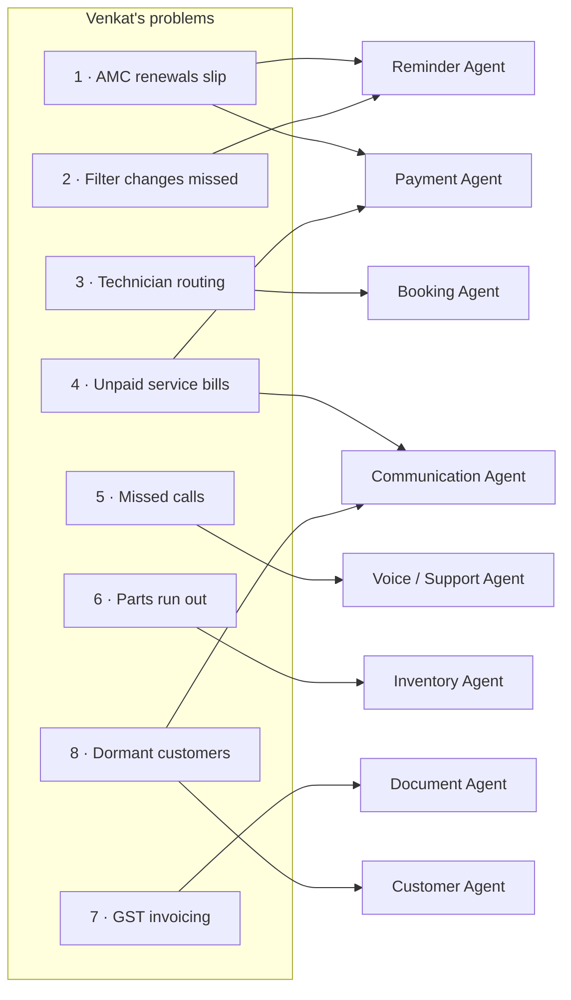

| Problem | Capability | Agents involved | Needs Venkat's approval? |
| --- | --- | --- | --- |
| 1 · AMC renewals | Reminders + Payment follow-up | Reminder, Payment, Customer, Communication | **Yes** — money and a message |
| 2 · Filter changes due | Reminders | Reminder, Customer, Communication | **Yes** — a message |
| 3 · Technician routing | Appointments | Booking | No — reading and proposing |
| 4 · Unpaid bills | Payment follow-up | Payment, Customer, Communication | **Yes** |
| 5 · Missed calls | Customer support | Voice ○, Support | Escalation only |
| 6 · Parts stock | Inventory | Inventory | **Yes** — a purchase order is money |
| 7 · GST invoices | Documents | Document | **Yes** — a financial record |
| 8 · Dormant customers | Customer follow-up | Customer, Communication | **Yes** |

## A day at Aqua Fresh

Venkat's Tuesday, with the system running as designed.

```mermaid
gantt
    title Tuesday at Aqua Fresh
    dateFormat HH:mm
    axisFormat %H:%M

    section Automatic ○
    Overnight — tomorrow's AMC visits confirmed   :07:00, 30m
    Filter-change reminders for next week         :08:00, 20m
    Stock check against reorder levels            :08:30, 10m

    section Venkat asks ●
    "What's on today?"                            :09:35, 10m
    "Who hasn't paid?"                            :11:00, 20m
    "Raise invoices for yesterday's jobs"         :14:00, 20m
    "Which AMCs expire this month?"               :17:00, 20m

    section Continuous ○
    Enquiries answered, escalations flagged       :09:30, 660m

    section Evening ●
    "Today's summary"                             :20:15, 15m
```

### 9:35am — "What's on today?" ●

The Booking Agent reads the diary. No approval needed; it only reads.

```
  Today's service jobs · Tuesday                        11 jobs · 2 technicians

  Mahesh — Miyapur cluster            Imran — KPHB cluster
  10:00  Filter change · Ramesh K     10:30  AMC visit · Sunitha M
  11:15  AMC visit · Padma R          11:45  Installation · new · Anil T
  12:30  Membrane · Syed I            13:00  Filter change · Rajesh V
  15:00  Complaint · low flow · GHMC  15:30  UV lamp · Kavitha S
  16:15  Filter change · Mohan D      16:45  AMC visit · Prakash B
                                      18:00  Complaint · leak · Farida B

  ⚠  2 jobs unconfirmed · ⚠ 15:00 complaint needs a 10-inch filter — 2 in stock
```

Two things Venkat could not see before: the jobs are **grouped by area**, so
neither technician crosses the city twice, and the system has already noticed
that today's complaint call needs a part that is nearly out.

### 11:00am — "Who hasn't paid?" ●

```
  ✓ Understanding your request                              Supervisor
  ✓ Planning workflow — Payment · Customer · Communication  Supervisor
  ✓ 23 overdue customers found                          Payment Agent
       Overdue accounts  23        Total  ₹41,300        Oldest  64 days
  ✓ Customer information retrieved                     Customer Agent
       19 prefer WhatsApp · 4 SMS · 0 on a payment plan
  ✓ 23 reminder messages prepared               Communication Agent
  ⏸ Sending messages requires your approval          Approval Gate
```

Venkat reviews. He switches off two — one paid cash yesterday and the counter
never recorded it, one is his cousin. He edits a third to be softer, because that
customer has bought three purifiers. He approves 21.

The system logs: *Venkat Rao approved "Payment reminders" · 21 records ·
₹38,100 · 11:07am*. That line can never be altered.

### 2:00pm — "Raise invoices for yesterday's work" ●

The Document Agent finds the jobs marked complete with no invoice, and drafts one
each with the correct GST treatment from the business's tax profile.

```
  Draft invoices · 7 records · ₹18,650                [ Reject ] [ Approve ]

  ☑  Sunitha M    AMC renewal 1 yr    ₹3,200   GST 18%   INV-2451
  ☑  Rajesh V     Filter change       ₹  850   GST 18%   INV-2452
  ☑  Anil T       RO installation     ₹9,500   GST 18%   INV-2453
  ☑  Kavitha S    UV lamp + labour    ₹1,400   GST 18%   INV-2454
  … 3 more
```

Problem 7 solved: the invoices are drafted the day after the work, not the
Saturday after the month.

### 5:00pm — "Which AMCs expire this month?" ●

This is Venkat's biggest financial problem, and it is the clearest example of
several agents working on one worksheet.

```
  ✓ Understanding your request                              Supervisor
  ✓ Planning workflow — Reminder · Customer · Communication  Supervisor
  ✓ 34 AMCs expiring in the next 30 days               Reminder Agent
       Expiring       34
       Value at risk  ₹1,02,000
       Already lapsed 9  (expired 1–3 weeks ago)
  ✓ Customer information retrieved                     Customer Agent
       27 renewed last year · 5 first-time · 2 complained recently
  ✓ 34 renewal messages prepared                Communication Agent
       Tone: warm for the 27 loyal · careful for the 2 with complaints
  ⏸ Sending requires your approval                    Approval Gate
       34 records · ₹1,02,000 · Policy: Always ask me
```

**₹1,02,000 of renewal revenue that would otherwise have quietly lapsed, surfaced
in twenty seconds and one question.** For a shop Venkat's size, that single
workflow is the business case for the whole product.

Note the Customer Agent's contribution: it flagged two customers who complained
recently, and the Communication Agent wrote to those two differently. That is the
kind of judgement a notebook cannot hold and a mail-merge will not make.

### 8:15pm — "Today's summary" ●

```
  Tuesday · Aqua Fresh Water Solutions

  Money in today            ₹22,400        ▲ 18% vs yesterday
  Jobs completed            9 of 11        2 rescheduled
  New enquiries             6              5 answered · 1 escalated to you
  Reminders sent            21             ▲ 4 replies, 2 paid already
  Outstanding               ₹41,300        ▼ ₹3,200 today
  AMC renewals in progress  34             ₹1,02,000 at stake
  Low stock                 4 items        purchase order awaiting approval

  Needs you tomorrow
  • Farida B — leak complaint, second visit. Escalated by the Support Agent
  • Purchase order ₹8,400 — 10-inch filters, membranes, 2 UV lamps
  • 5 AMC customers have not replied to the renewal message
```

### The two automatic ones ○

These two need the scheduling engine that does not exist yet, and they are the
ones Venkat would value most, because they require nobody to remember anything.

**Every evening at 7pm** — the Reminder Agent looks at tomorrow's service jobs,
finds the unconfirmed ones, and prepares a confirmation message for each. Venkat
approves in one tap. Customers who do not reply by morning are flagged so a
technician is not sent to an empty house.

**Every morning at 8am** — the Reminder Agent looks 7 days ahead for filter
changes falling due, and prepares *"Hi Ramesh, your Aqua Fresh filter change is
due next week. Shall we send Mahesh on Thursday morning or Friday evening?"* —
which converts a maintenance obligation into a booked, paid job.

Problem 2 solved, permanently, without Venkat thinking about it once.

## Before and after

| | Before | After |
| --- | --- | --- |
| AMC renewals | Notebook, ~35% lapse | 34 surfaced 30 days ahead, one approval |
| Filter reminders | Nobody calls | Weekly, automatic, converts to bookings ○ |
| Technician routing | Crossing the city twice a day | Grouped by area |
| Payment chasing | Awkward, sporadic | 23 drafted in 20 seconds, owner reviews |
| Missed calls | Lost sales | Answered and logged ○ |
| Parts stock | Found out at the customer's house | Flagged against today's jobs |
| GST invoices | Saturday, or never | Next day, drafted, one approval |
| Dormant customers | No list exists | Segmented, with a win-back message each |
| Venkat's evening admin | 1.5–2 hours | ~15 minutes of reviewing and approving |

The last row is the honest measure of value. The system does not remove
decisions from Venkat — it removes the *finding, listing, drafting and
remembering*, and leaves him only the deciding.

## Why this generalises

Nothing above was built for water purifiers. Swap the business and the same nine
capabilities and eleven agents fit:

| Business | AMC renewal becomes | Filter change becomes | Parts become |
| --- | --- | --- | --- |
| Gym | Membership renewal | Fitness assessment due | Supplements stock |
| Coaching centre | Term fee due | Parent-teacher session due | Study material |
| Salon | Package expiry | Touch-up due | Product stock |
| Laundry | Monthly plan renewal | Pickup due | Detergent stock |
| Pest control | Annual contract renewal | Quarterly treatment due | Chemical stock |
| Car service | Insurance renewal | Service interval due | Spares |

**That is the reason the capabilities are named generically.** "Payment
follow-up" and "Reminders" describe every one of those businesses. "AMC renewal
chaser" would describe one.

---

# Part 11 · Honest status

## What works today ●

1. Create an account, sign in, sign out, reset a password
2. Create a business workspace through a four-step guided setup
3. Choose which capabilities the business has, and change them later
4. Belong to more than one business and switch between them
5. Be refused another business's data — enforced by the database, not the screens
6. Be refused a workspace you have no role for, before any page is built
7. Type a request in plain English and have it correctly understood, in nine
   categories, in the right vocabulary for the industry
8. Watch the workflow run, with **real counts and real records** at every step
9. Reach a genuine approval gate, review every record, switch records in or out,
   edit any message, approve or reject
10. See every screen in light and dark, on a phone, tablet or desktop, with
    keyboard navigation throughout
11. Edit the business profile, hours and settings
12. 33 screens, all complete, with proper loading, empty and error states

## What is designed but not built ○

| Missing | Consequence |
| --- | --- |
| **The AI itself** | Requests are matched by keyword, not understood by a model. The step sequences are pre-written |
| **The sending layer** | After approval, nothing is sent. The activity trail says "executing" and nothing executes |
| **The scheduler** | The eight "always-on automations" are listed with switches; toggling one shows a message and does nothing. Nothing runs at 7pm |
| **Inbound channels** | Customers cannot message, book or pay. Nothing receives a reply |
| **The Voice Agent** | Not started. No model assigned |
| **Persistent business records** | Customers, invoices, bookings and stock are generated in the browser and reset on refresh. 19 of 24 database tables are unused |
| **A knowledge base** | The Support Agent has no business information to answer from |
| **Error reporting and monitoring** | A failure in production would be invisible |

## The build order that follows

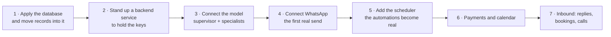

Step 4 is the milestone that changes what the product *is*. Everything before it
is preparation; the first approved message that actually reaches a customer's
phone is the moment the product starts working.

Two things are worth saying about that sequence. First, **the order is forced**:
you cannot connect a model safely without a server to keep the key on, and you
cannot schedule work that has no way to act. Second, **none of it requires
changing the screens.** The interface, the approval mechanism, the vocabulary
system and the audit design are finished and correct. What is missing sits behind
a single, well-defined doorway.

---

# Glossary

| Term | In plain words |
| --- | --- |
| **Agent** | One AI worker with one job and its own tools |
| **Supervisor** | The agent that understands the request and decides who does what |
| **Specialist** | An agent that does one kind of work: payments, bookings, messages |
| **Capability** | A power a business switches on — "payment follow-up", "reminders" |
| **Approval gate** | The stop where a human decides before anything reaches a customer |
| **Approval batch** | A set of prepared records shown for review together — 23 reminders, 7 invoices |
| **Intent** | What the system decided you were asking for |
| **Workflow run** | One request from typing to finished, with all its steps |
| **Step** | One visible unit of work by one agent, with what it found |
| **Activity trail** | The permanent record of everything the AI did and every human decision |
| **Workspace / tenant** | One business's private area. Switching workspaces switches everything |
| **Vocabulary** | The industry's own words — member vs customer, class vs appointment |
| **Escalation** | The AI deciding it should not answer, and handing it to a person with context |
| **Reorder level** | The stock quantity at which the Inventory Agent proposes buying more |
| **AMC** | Annual Maintenance Contract — the recurring service revenue in Venkat's trade |

---

## Where to go next

| If you want | Read |
| --- | --- |
| The plain-language system overview | `01_SYSTEM_OVERVIEW.md` |
| What the agents actually are in code | `05_AGENT_ARCHITECTURE.md` |
| A line-by-line trace of one run | `06_AGENT_EXECUTION_TRACES.md` |
| The database and the privacy model | `11_DATABASE_ARCHITECTURE.md` |
| Every screen and what it does | `03_USER_WORKFLOWS.md` and `21_FEATURE_IMPLEMENTATION_MAP.md` |
| Everything known to be missing or broken | `32_UNKNOWN_BROKEN_INCOMPLETE.md` |
