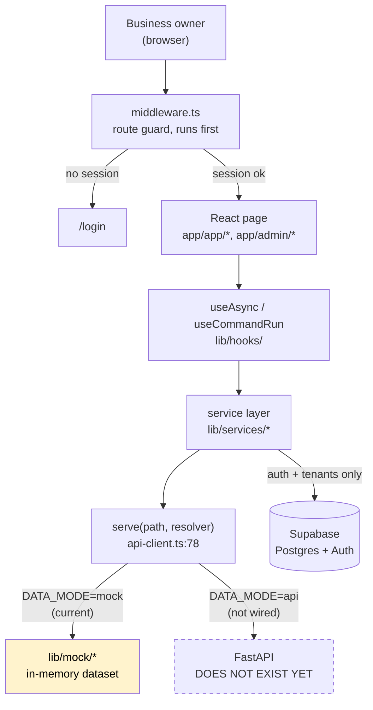

# AI Business Hub — technical knowledge base

Reverse-engineered from the code in this repository, not from the product pitch.
Everything here cites real files, functions and line ranges. Where something the
architecture appears to need does not exist, that is stated rather than filled in.

**Verified on commit `817cc8f`** (2026-09-10).

---

## Read this first: what is actually built

The product describes an AI workforce. The repository contains a **complete
frontend for that product**, a **real Postgres schema**, and **real
authentication**. It does not yet contain the AI.

| Subsystem | State | Evidence |
| --- | --- | --- |
| Frontend — 33 pages, 62 components | **Implemented and used** | `app/`, `components/` |
| Authentication, session, route guards | **Implemented and used** | `middleware.ts`, `lib/supabase/` |
| Postgres schema, RLS, audit immutability | **Implemented, not yet applied** | `supabase/migrations/` (9 files) |
| Tenants, membership, capability config | **Implemented and used** | `lib/supabase/businesses.ts` |
| Customers, payments, bookings, approvals, activity | **Mock data** | `lib/mock/` |
| HTTP API | **Does not exist** | no `route.ts` anywhere in `app/` |
| AI agents | **Does not exist** — 12 static metadata rows | `lib/mock/agents.ts` |
| LLM calls | **Does not exist** — provider names in config only | `lib/config.ts:44-90` |
| Prompts, tools, RAG, vector DB | **Do not exist** | zero occurrences, see `05`–`10` |
| Queues, workers, schedulers, streaming | **Do not exist** | see `16` |

If you are about to tell someone "this project uses agents and LLMs", read
[`05_AGENT_ARCHITECTURE.md`](05_AGENT_ARCHITECTURE.md) and
[`07_LLM_ARCHITECTURE.md`](07_LLM_ARCHITECTURE.md) first. The honest sentence is:
*"the AI workforce is designed and staged, and the seam it will attach to is two
functions wide."*

---

## Where to start

**If you have 20 minutes** — read
[`01_SYSTEM_OVERVIEW.md`](01_SYSTEM_OVERVIEW.md), then
[`27_COMPLETE_SYSTEM_WALKTHROUGH.md`](27_COMPLETE_SYSTEM_WALKTHROUGH.md).
Together they answer "what happens when I click this button".

**If you are new to backend and AI concepts** — start at
[`28_LEARN_THIS_PROJECT_FROM_ZERO.md`](28_LEARN_THIS_PROJECT_FROM_ZERO.md), which
teaches only the concepts this project actually uses, easiest first.

**If you are about to read the code** — follow
[`29_CODE_READING_ORDER.md`](29_CODE_READING_ORDER.md). It is dependency-ordered,
not alphabetical.

**If something is broken right now** — [`30_DEBUGGING_GUIDE.md`](30_DEBUGGING_GUIDE.md).

**If you are about to change something** — [`31_MODIFICATION_GUIDE.md`](31_MODIFICATION_GUIDE.md).

---

## Architecture in one diagram



Two data paths coexist today. Authentication and the tenant list are real and go
to Supabase. Everything else — customers, invoices, bookings, approvals, the
activity trail — is generated in the browser by `lib/mock`.

---

## All documents

### Understand the system
| # | Document | What it answers |
| --- | --- | --- |
| 00 | [System inventory](00_SYSTEM_INVENTORY.md) | Every component, its status, who calls it |
| 01 | [System overview](01_SYSTEM_OVERVIEW.md) | What this is, who uses it, how the parts fit |
| 02 | [System architecture](02_SYSTEM_ARCHITECTURE.md) | Diagrams for every layer and lifecycle |
| 03 | [User workflows](03_USER_WORKFLOWS.md) | Each feature traced from click to render |
| 27 | [Complete walkthrough](27_COMPLETE_SYSTEM_WALKTHROUGH.md) | **The main document.** End to end, in order |
| 34 | [Final system map](34_FINAL_SYSTEM_MAP.md) | One page to re-orient yourself |

### The interfaces
| # | Document | What it answers |
| --- | --- | --- |
| 04 | [API reference](04_API_REFERENCE.md) | The 66 service paths; why none are HTTP endpoints yet |
| 13 | [Frontend architecture](13_FRONTEND_ARCHITECTURE.md) | Routing, state, data fetching, rendering |
| 14 | [Backend architecture](14_BACKEND_ARCHITECTURE.md) | What backend exists (middleware + Supabase) and what does not |

### The AI layer — read the status lines carefully
| # | Document | What it answers |
| --- | --- | --- |
| 05 | [Agent architecture](05_AGENT_ARCHITECTURE.md) | The agent *model*, and that no agent runs |
| 06 | [Agent execution traces](06_AGENT_EXECUTION_TRACES.md) | Line-by-line trace of the simulated run |
| 07 | [LLM architecture](07_LLM_ARCHITECTURE.md) | Configured models, none called |
| 08 | [Prompt architecture](08_PROMPT_ARCHITECTURE.md) | No prompts exist; the text that stands in for them |
| 09 | [Tool architecture](09_TOOL_ARCHITECTURE.md) | No tools exist; the data reads that will become them |
| 10 | [RAG architecture](10_RAG_ARCHITECTURE.md) | No RAG. Short document |

### Data
| # | Document | What it answers |
| --- | --- | --- |
| 11 | [Database architecture](11_DATABASE_ARCHITECTURE.md) | 24 tables, ER diagram, RLS, triggers |
| 12 | [Data flow](12_DATA_FLOW.md) | Every transformation from keystroke to row |

### Operations
| # | Document | What it answers |
| --- | --- | --- |
| 15 | [Security architecture](15_SECURITY_ARCHITECTURE.md) | What protects what, and 11 ranked findings |
| 16 | [Async processing](16_ASYNC_PROCESSING.md) | None exists. What simulates it |
| 17 | [External integrations](17_EXTERNAL_INTEGRATIONS.md) | One live (Supabase); the rest are catalogue rows |
| 18 | [Configuration](18_CONFIGURATION.md) | Every variable, where it is read, what breaks without it |
| 22 | [Error handling](22_ERROR_HANDLING.md) | Every failure path to a user-visible message |
| 23 | [Testing architecture](23_TESTING_ARCHITECTURE.md) | 220 tests, and what has none |
| 24 | [Deployment architecture](24_DEPLOYMENT_ARCHITECTURE.md) | CI as it exists; no deployment target configured |

### The code itself
| # | Document | What it answers |
| --- | --- | --- |
| 19 | [Codebase file guide](19_CODEBASE_FILE_GUIDE.md) | Every meaningful file, purpose, callers |
| 20 | [Code dependency map](20_CODE_DEPENDENCY_MAP.md) | Import chains, hot modules, cycles |
| 21 | [Feature implementation map](21_FEATURE_IMPLEMENTATION_MAP.md) | Feature to file, in one table |
| 25 | [Performance](25_PERFORMANCE_ARCHITECTURE.md) | Confirmed issues vs possible optimisations |
| 26 | [Code quality audit](26_CODE_QUALITY_AUDIT.md) | Duplication, dead code, debt, with severities |
| 32 | [Unknown / broken / incomplete](32_UNKNOWN_BROKEN_INCOMPLETE.md) | Everything staged, unused or disconnected |

### Learning and working
| # | Document | What it answers |
| --- | --- | --- |
| 28 | [Learn this project from zero](28_LEARN_THIS_PROJECT_FROM_ZERO.md) | Concepts, easiest first, only what is used |
| 29 | [Code reading order](29_CODE_READING_ORDER.md) | The order to read files in |
| 30 | [Debugging guide](30_DEBUGGING_GUIDE.md) | Symptom to root cause |
| 31 | [Modification guide](31_MODIFICATION_GUIDE.md) | "I want to add X" — where to edit |
| 33 | [Glossary](33_GLOSSARY.md) | Terms, defined as this project uses them |

Also: [`connect-supabase.md`](connect-supabase.md) — the operational runbook for
pointing this at a Supabase project.

---

## Recommended reading order

1. `01_SYSTEM_OVERVIEW.md` — orientation
2. `27_COMPLETE_SYSTEM_WALKTHROUGH.md` — the whole flow once, end to end
3. `11_DATABASE_ARCHITECTURE.md` — the data model everything is shaped by
4. `05_AGENT_ARCHITECTURE.md` — so you can describe the AI layer accurately
5. `19_CODEBASE_FILE_GUIDE.md` — then read the code with `29_CODE_READING_ORDER.md`

---

## Quick reference

```bash
npm run dev            # http://localhost:3000  (predev clears .next/diagnostics)
npm run verify         # typecheck + lint + 220 unit tests
npm run build          # fails if Supabase env is missing — see 18
npm run db:push        # not a script; use: npx supabase db push
npm run db:test        # pgTAP tenant-isolation suite (needs Docker)
npm run seed:generate  # regenerate supabase/seed.sql from lib/mock
```

| I want to find… | Look in |
| --- | --- |
| The domain model | `lib/types.ts` — 1 file, every entity |
| Where data comes from | `lib/services/api-client.ts:78` — the one seam |
| Industry vocabulary and status colours | `lib/domain.ts` |
| Every config value and env var | `lib/config.ts` |
| The route guard | `middleware.ts` |
| The "AI" | `lib/mock/workflows.ts` + `lib/hooks/use-command-run.ts` |
| The schema | `supabase/migrations/` |

---

## Known issues and warnings

Full detail in [`32`](32_UNKNOWN_BROKEN_INCOMPLETE.md) and
[`26`](26_CODE_QUALITY_AUDIT.md). The ones that will bite you first:

1. **The migrations have never been applied anywhere.** No Docker on the
   development machine, so `supabase db push` has not been run. The SQL is
   unexecuted — expect to fix something the first time it runs.
2. **Two data paths are live at once.** Auth and tenants are real; records are
   mock. `lib/mock/demo-bridge.ts` maps a real tenant UUID onto the sample
   dataset. A workspace you create yourself will look empty, correctly.
3. **The security guard is a build-time property.** `NEXT_PUBLIC_*` values are
   inlined at build, including into middleware. Build without them and the guard
   is compiled out. `next.config.mjs:22` fails the build to prevent this.
4. **`date-fns` is installed and never imported** — see `26`.
5. **`npm run db:*` scripts need Docker**, which is absent on the development
   machine. CI runs them.
6. **This project runs from a synced OneDrive folder**, which breaks
   `next dev` after `next build`. `scripts/clean-next-diagnostics.mjs` works
   around it.
